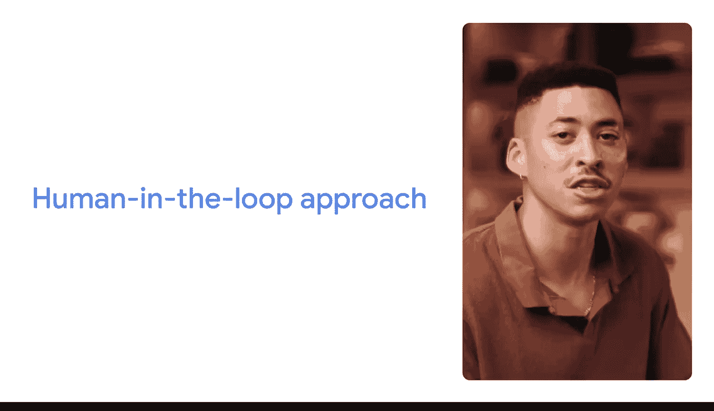

# 谷歌《谷歌商业智能（BI基础、洞察路线：模型和pipelines、决策：数据看板）｜Google Business Intelligence》 p123 44_05_04_利用人工智能提升数据分析技能.zh_en -BV1yJ4m1V7W9_p123-

AI is transforming the way we approach everyday task in work and in life。

 Uing AI can help you get more routine things done quickly and empower you to spend more time in places where you can have the most impact。

Think about your typical day at work。 It was anything like mine。

 You have a lot of things to do and not enough time。 Some days。

 your to do list might seem never ending。 But what if AI could help as a fellow data professional。

 I'm here to share a few situations you may encounter where AI can help you work smarter and faster。

 And I'll even show you how to do it。 You'll discover how to speed up the data cleaning process。

 create engaging visuals to showcase your data。 Come up with questions for data analysis and more。😊。

My name is Miles， and I'm a data engineer on the revenueue systems team here at Google。

 My team works with data that relates to Google's finances。Specifically， I maintain large。

 structured or unstructured databases known as data lakes， which contain our financial data。

 I often automate data reporting for revenue generating programs and assist our stakeholders with analysis to help our products and programs grow。

 AI helps me work more efficiently and creatively。 So I'm excited to share how I'm using it。😊。

To get the most out of geneative AI or gene AI， it's important to write an effective prompt。

 A prompt is the input you provide the AI model to elicit a specific response。

 A good prompt follows a simple framework。 task， context， references， evaluate and iterate or T， C。

 R， E， I。 If you ever forget a step， Just remember， thoughtfully create really excellent inputs。

First is task。 What do you want the model to do fairly simple and straightforward， right。

 We can break task into persona and format。Persona refers to what expertise you want the GN tool to draw from。

You can ask the tool， take on a persona like a professional speechwriter or a marketing executive with 15 years of experience。

 or you can ask it to create output for a specific audience， a customer， or even your manager。😊。

You can be as detailed as youd like when adding a persona to your task。

Format refers to how you want the output to appear。Whether that's a bulleted list。

 short sentences or a table。 And keep in mind， the task should be clear and specific about what you want the model to do。

Next， you'll include context。 These are the necessary details to help the Gin AI tool understand what you need from it。

This is the difference between writing。 Give me some ideas for a birthday present under $30。

 and give me 5 ideas for a birthday present。 My budget is $30。

 The gift is for a 29 year old who loves winter sports and has recently switched from snowboarding to skiing。

😊，Third， sometimes you'll add references for the JAI tool to use while creating its output。

You've just asked a GenAI tool to give you ideas for a birthday present， right， Well。

 if you add examples of birthday presents you've given in the past as references。

 the GenAI tool can give you a more useful output。Keep in mind。

 there aren't always going to be clear references of what you need。

 especially if you're working on something more abstract or searching for ideas and inspiration。

 It's all about being clear and specific in your instructions。 Use natural language。

 right as if you're speaking to another person and express complete thoughts。Okay。

 so you've included the task， context and references in your prompt。Once you have the output。

 it's time to evaluate。Ask yourself if the input you provided gave you the output you needed。

 This leads us to the final part of the framework。 Iterate。

 if you evaluate your output and determine that you're not getting what you need。

 you can try again by adding more information or editing your prompt。

 This is a key part in prompting effectively。One more note on framework。

 There are plenty of ways to construct an effective prompt。

 The order of how you construct a prompt is less important than the substance of the prompt itself。

As long as you' are thoughtfully creating really excellent inputs， your output should be great。😊。

As we explore how to use AI and data analytics， keep in mind that AI works best when used as a complement to our uniquely human skills and abilities。

 you should always use AI responsibly by applying a human in the loop approach。

AI is a useful tool to help you accomplish task， but it requires human involvement。

 No AI tool has a depth of experience， practical knowledge and interactive skills that we do。

 That's why human and loop approach is key to using AI responsibly。

 It combines machine and human intelligence to train， use， verify and refine AI results。

 in practical terms， this means being mindful of what you put into an AI tool in always evaluating and verifying what comes out。

 When you work with AI tools， carefully consider If you need to use confidential or sensitive information to perform your task。

 and always consult your organization's rules or policies first。😊。

Even when you're using AI tools outside of work， you should avoid entering personal or confidential information and always check how the data you enter might be used。

 One last thing， there are a lot of Gen AI tools out there。

 I'm going to demonstrate how to prompt using Gemini。

 but all the techniques and best practices you'll learn can be applied to other G AI tools like chat GT。

 Copit or Clade。Data analysts like us are often bogged down by time consuming tasks like cleaning and organizing data。

 I don't think I've ever met someone who said that this is their favorite part of the job。

 The real excitement comes from finding discoveries in the data。

 going deeper on insights and working with teams to help turn those insights into decisions。

 AI tools can empower us data professionals to play a bigger role in unlocking opportunities for our teams or organizations。

😊，Now， let's get started。