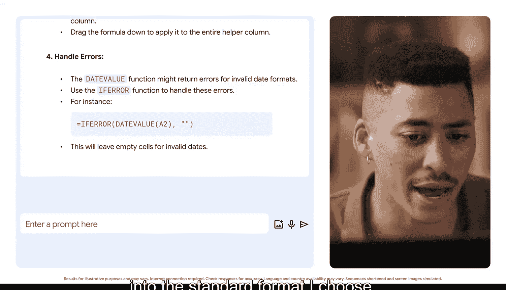

# 谷歌《谷歌商业智能（BI基础、洞察路线：模型和pipelines、决策：数据看板）｜Google Business Intelligence》 p124 45_05_05_借助人工智能清洗与准备数据.zh_en -BV1yJ4m1V7W9_p124-

How many hours have you spent getting data ready for analysis on things like cleaning spreadsheets。

 fixing bad data， changing data types to be accurate and representative， or one of my favorites。

 renaming columns For me， The answer is， Well， a whole lot of hours In our field。

 Clean data is the foundation for any analysis。 As data analyst， we typically get large， incomplete。

 sometimes erroneous data sets， either from stakeholders， external vendors。

 or even just from old code and databases for each data， I can spend up to 30% of my time cleaning。

 validating and preparing it for analysis。 It can be tedious。😊。

AI has helped me reclaim some of these hours for deeper analysis to do the work I really love G AI tools like Jim and I can help data analysts identify data quality issues。

 standardized date formats， detect and remove duplicates。

 identify potential data set features in record time。For example。

 Gemin I can provide a detailed process for achieving a high quality data。

 and with more advanced tools like Gemin I for Google Workspace。

 we can grant access to a dataset and have the tool complete the changes for us。

Think of a recent data set you worked with， it could be a data set from this certificate program or from a project at work you recently completed。

Pause a video if you have to and really think of one。

What were the most common issues you faced when trying to clean that data， bad data types。

 missing information， unclear field names？What if AI could help with all of that with a little prompting from you？

Let me show you an example。 Imagine I have a data set describing daily sales data。

 This data set has inconsistent date formats。 Frustrating， right？

 How do I even go about fixing those？ Well， I could enter a prompt like this。

I've received a sales data set that contains numerous formatting issues。Specifically。

 they are inconsistent date formats。 I'm going to go ahead and enter some generic dates。

 as an example。Describe a step by step process for cleaning and standardizing the date formats exclusively in Google Sheets to ensure the data is ready for accurate analysis。

Now， let's check out the output。Jim and I provide steps on how to identify the columns of my data that may contain dates。

 Then it offers tips to make it easier to figure out which fields have dates and how to pick a standard format so that all the dates are shown the same way。

It even gives me notes on error handling and lets me know the safest way to convert the information into the standard format I choose。

Pretty cool， right， Clean data for all。In this example。

 Jim and I guided us through the process for cleaning and standardizing the date formats。

 But this is just the tip of the iceberg when it comes to Gen AI's capabilities in data analysis。

 Many enterprise level AI tools can go even further by automating data cleaning tasks like these。

 This can save valuable time and resources， allowing you to focus on things like strategic decision making。

 Now， try it out for yourself。 Play and experimenting with prompts is the best way to figure out how to get results that are useful for you。

 Open a data set you're currently working with and see how a G AI tool can help。😊。

Getting the output you want can be a journey sometimes。

 and the only way to get there is to get comfortable， explore， and learn what path works for you。

