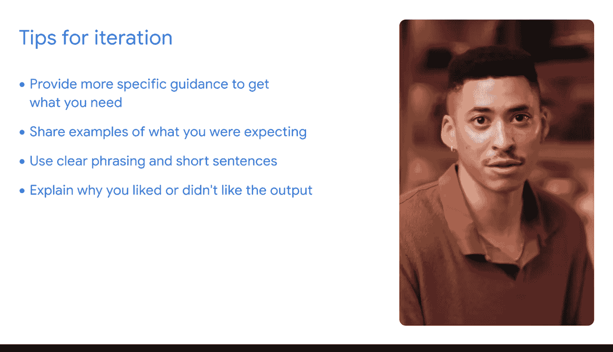

# 谷歌《谷歌商业智能（BI基础、洞察路线：模型和pipelines、决策：数据看板）｜Google Business Intelligence》 p125 46_05_06_使用人工智能组织数据与构建公式.zh_en -BV1yJ4m1V7W9_p125-

If there's one thing I love， it's a well organized and well kept spreadsheet。 But getting there。

 spending hours of time organizing data， establishing formulas， creating pivot tables。

 remembering complex menus and formats。 Now， that's a different story。😊，Fortunately。

 Gen AI tools can help not only with cleaning data， but with organizing it too。

 which means you get to focus more on deep analysis and less on setup。

 plus you get some beautifully organized data to geek out over。

Imagine I'm working with a dataset that contains product sales information across different regions and different time periods。

 I want to restructure this data to show monthly sales summaries for each product in each region。

I chose this example because it's similar to a situation I recently encountered at work where I relied on Gemini for help。

 I had to find the monthly sales growth of a new product we were offering in the Americas。

 but it only had the raw output of our data tables in a spreadsheet。So how should I start？First。

 I'll open my spreadsheet to make sure the data is as clean as possible。

 I may even use some help from AI with that。I'll confirm that I know relevant field names and structure。

 and I'll check for potential issues。Then I'll open a gen eye tool。 Jim and I in this case。

 But the same process applies to others and begin prompting。 As usual。

 I'll focus on describing the task I want the model to perform。

 adding enough details for context and providing any necessary references。 Well。

 I could enter a prompt like this。I have a data set in Google sheetets containing information on product sales across different regions and time periods。

 My goal is to restructure the data to show monthly sale summaries for each product in each region。

Help me brainstorm key considerations before I begin this work and also identify any specific formulas that might be useful for this task。

As you'll notice， we started with a simple prompt， describing our goal to restructure sales data into monthly summaries。

 We didn't need to give Gemini any code or complex instructions。

 just a clear explanation of our desired outcome。Now， let's check our Geminize's response。

Think of Gemini as a project consultant， guiding us through the crucial planning stages。

As we can see， Ge and I emphasizes understanding the structure of our data and highlights the importance of some key fields then。

Jim and I recommends pivot tables as a powerful tool for this type of data transformation。

It even suggests several useful formulas we can implement。

One formula I particularly enjoy from this output is some ifs showing how to create aggregations based on parameters we set。

 And keep in mind， the more specific our prompt， the better the output。 In this example。

 letting Jim and I know that we're using Google sheets allows our response to be tailored to that tool。

 which can make our lives a whole lot easier。😊，Remember the prompt framework， TCR EI。

 this is where we're going to put the E or evaluate into action。In an ideal world。

 Jim and I gives me exactly what I need to get my data set organized， but I'll need to check。

If the first output isn't exactly what I'm hoping for。

 then the eye or iterate comes in more likely than not。

 I'll want to iterate on my prompt to get more accurate or more useful results。

 depending on my preferences。As a reminder， iteration is the process of refining and improving your AI prompts and outputs through repeated cycles of testing and adjustment。

Here are a few tips you can keep in mind。When you evaluated your prompt。

 did you find any areas where the output didn't align to your expectations。 If so。

 there may be opportunities to provide the AI tool with more specific guidance about what you need。

 Remember， an AI tool can only provide results based on what you tell it to do。

 So make sure your prompt has enough detail to get a useful response。

Or think back to the R and our prompting framework， references。

Can you share an example of what you were expecting。

 providing examples in your prompt can help the AI tool understand what you want。

If you're hoping to find a specific format or type of analysis， show the AI tool one example。

Another thing you can do is check your phrasing。Were you as clear as possible。

 Try breaking your instructions into shorter sentences。

This can help you improve the output the next time。Are there parts of the output that you did like。

For example， imagine the AI tool gave you five ideas for a brainstorm， and you liked two of them。

In your next prompt， explain why you like those two and ask the AI tool to provide a new list of ideas based on your reasoning。

You can even point out why you didn't like the other three ideas and ask the tool to take that into account for the next time around as well。

So how would I iterate on the prompt I shared earlier？

Let's say the AI Tool response contained only general information about pivot tables。

 and I wanted to learn more。That I may need to include field names of my inputs or specify which fields for my data I like to include in that pivot table。

 Or if the response didn't include specifics for the independent versus dependent variables。

 the rows and columns of our pivot table respectively， I may add context。

 So that information is in my output as well。Through the power of effective prompting and creative iteration。

 I can work with Gemini to develop a process for organizing my sales data and more advanced JI tools like Gemini and Google Sheets can go beyond process recommendations to generate a pivot table for you or even multiple options for you to choose from。

😊，Pretty cool， right？