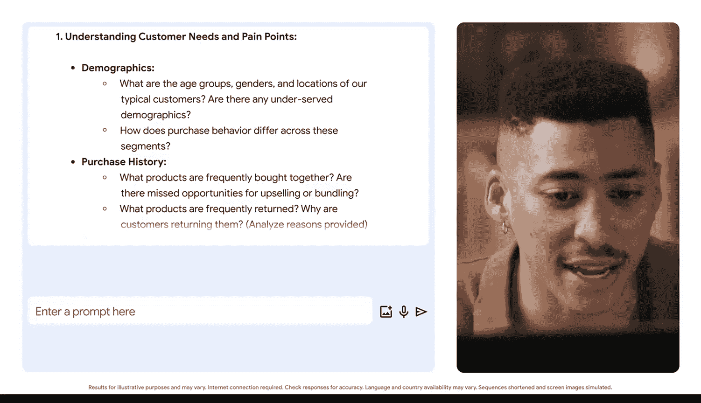

# 谷歌《谷歌商业智能（BI基础、洞察路线：模型和pipelines、决策：数据看板）｜Google Business Intelligence》 p126 47_05_07_运用人工智能提出更有效的问题.zh_en -BV1yJ4m1V7W9_p126-

Great data analysis starts with great questions。 Before you can answer questions with data。

 you need to know what you're asking。 Only then can you unlock actionable insights and smarter decisions At the end of the day。

 the data reports we create as analysts are supposed to help drive decisions。

 That means the questions we ask ahead of time， greatly impact what can be answered with our reports。

 As you probably guessed， G AI tools can help with this important task of defining the right questions。

 Prese， relevant， actionable questions for effective data analysis。😊，Let's go through an example。

 Suppose we're data analysts working together for a retailer。

 and we're trying to figure out how to improve the customer experience。 I might write a prompt like。

I was given access to a comprehensive data set for an online retailer that includes customer demographics。

 purchase history， and website interaction logs。What are the key questions I should formulate to guide an analysis aimed at improving customer experience and increasing sales。

 describe the steps to define and prioritize these questions。here we go。

 I get a list of potential questions to ask about my dataset。

 as well as what I can do to start answering them。

And here's a pro tip。 you can ask the AI tool to rate itself with the output or stack rank the potential questions。

 It tends to give multiple results and will scale them based on how well it thinks it did or how easy the questions will lead you to insights nice。

Ready for something even cooler？As a data analyst， there are more advanced tools。

 some of them paid that let you do even more things with your data In my job。

 I use Jim and I Adv to connect data sources directly to the model instead of me clicking around in my data。

 hoping to find a trend that stands out to me， Jim and I analyzes the data I present。

 and with a couple of questions， it can highlight major trends and patterns， saving me a lot of time。

😊，From this summary， I can start formulating deeper analysis。

 which gives me an extra boost in productivity。Defining good questions is critical for successful data analysis AI can help you streamline this process so that your questions are precise。

 relevant， and actionable。 This will enhance your analysis and lead to deeper insights in better decision making。

Now， try applying these techniques to your data。