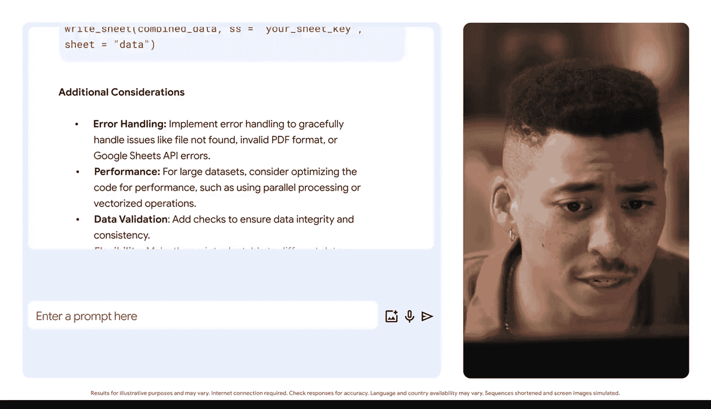

# 谷歌《谷歌商业智能（BI基础、洞察路线：模型和pipelines、决策：数据看板）｜Google Business Intelligence》 p128 49_05_09_借助人工智能优化R代码.zh_en -BV1yJ4m1V7W9_p128-

Writing our code can sometimes feel like navigating a maze， at least it's felt that way to me。

GenAI can help with this。As a data analyst， you might be tasked with cleaning and transforming your data set。

You can prompt Gemin I or another GAI tool to generate the initial R script for example。

 your' prompt my AS the AI tool to generate an R script to read a CSV file and clean the data by removing null values。

AI can provide a well structured script， which you can then refine This can save data analysts like us time and can help make our work more accurate。

 Debugging our code is another area where AI really shines common R errors such as syntax mistakes or logical errors can be quickly identified and corrected with AIs help。

 For instance， if you get an error when running a script， you can describe the issue to an AI tool。

 and it will suggest possible solutions， So if you get an error while trying to join two data frames。

 AI can point out that you might have missed the column name or use the wrong function。😊。

You can start to understand how AI can cut down on your debugging time。

One of our strengths is its ability to handle data from various sources。

AI can help streamline this process by generating code to read and aggregate data for instance。

 you might need to read data from CSV files， databases and APIs by prompting a JAI tool you can get a script that reads the data from these sources ands them into a single data frame。

So how could I build a prompt to tackle a challenge like this， Well。

 I could try writing a prompt like。I'm a junior data analyst with basic knowledgeled of R。

I need help creating the base outline for an R script that automates loading data from various sources。

 i。e， PDFs and Google Sheets， I want the code to scan each document， organize the data。

 and produce one single organized Google sheet that does not include duplicate data。Check this out。

In addition to providing a basic framework， Jim and I asked for clarification about the data structure。

 consistency between sources and other elements。 The model generates a basic outline for an R script to automate the data loading。

 cleaning， emerging process， along with explanations to help build it out。Plus。

 it provides a few pointers about issues I should take into consideration。

Not bad， with just one prompt， I got a little help with my R coding。

Integrating Gin AI into your R workflow isn't only about efficiency， it's also about empowerment。

You can tackle more complex projects and uncover cover deeper insights。 Remember。

 you don't need to be an R expert to harness the power of AI。 Just start experimenting。

Like with any new technology， we all need to try， test， and play in order to learn how to use AI。

I really enjoyed being able to share some of the ways I'm using AI in my work as a data professional。

 from helping with data cleaning to coming up with ideas for data visualizations。

I hope this can help you start to use AI in your role。 My challenge for you。

 Think about the work you're already doing。Is there something that's taking you a lot of time。

 a project where you need some ideas to get started。

 commit to experimenting with AI for something that will make a real difference to you and your work？

