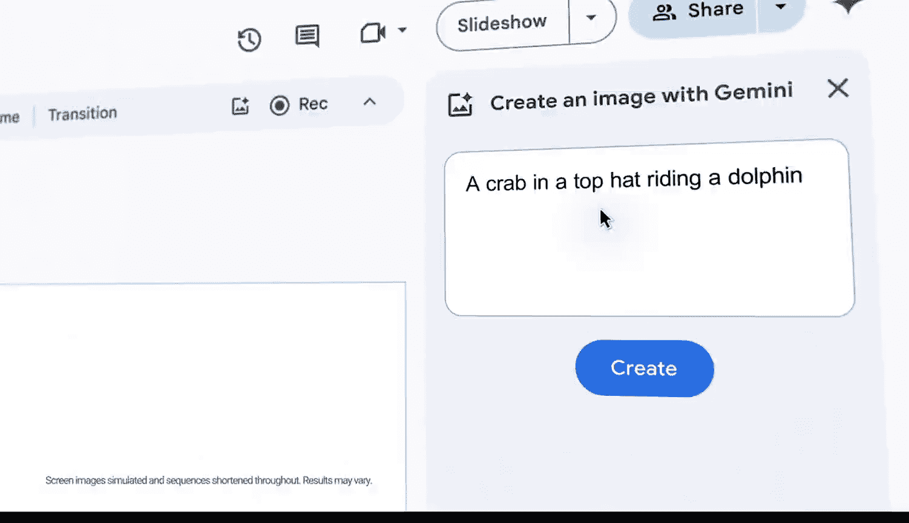
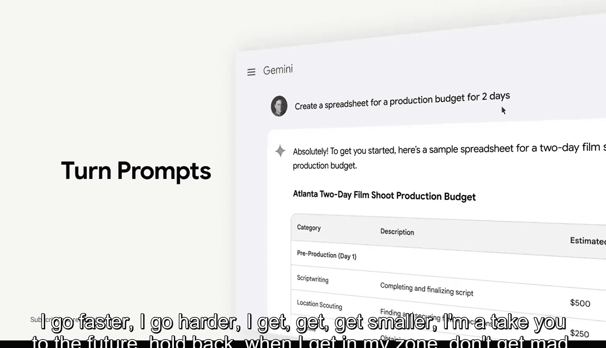
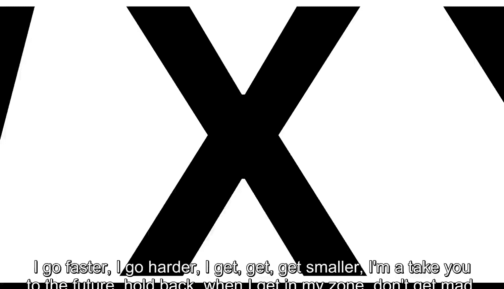
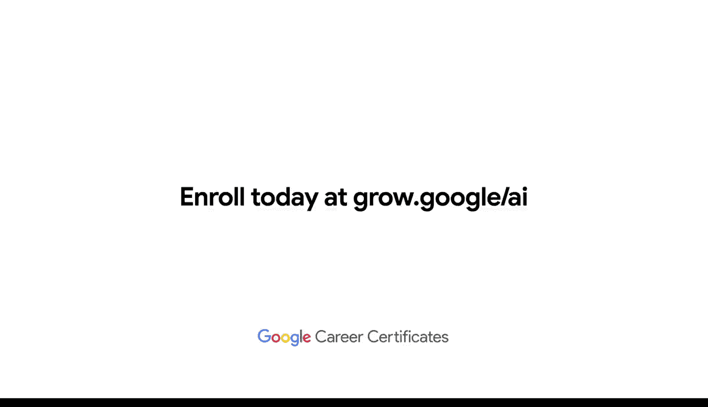

# 谷歌《谷歌商业智能（BI基础、洞察路线：模型和pipelines、决策：数据看板）｜Google Business Intelligence》 p129 50_05_11_谷歌人工智能基础课程介绍.zh_en -BV1yJ4m1V7W9_p129-

I am not like them or the others Dont back down， I don't run for cover。 I'm a bus top dog， no time。

🎼Beginners， only winners and。🎼在啦。

I'm a take to the future。🎼后背。

Okay man， it's just like dead it's just like that。

Wow，' to the future。

🎼阿高好。I'm a take to the future。

