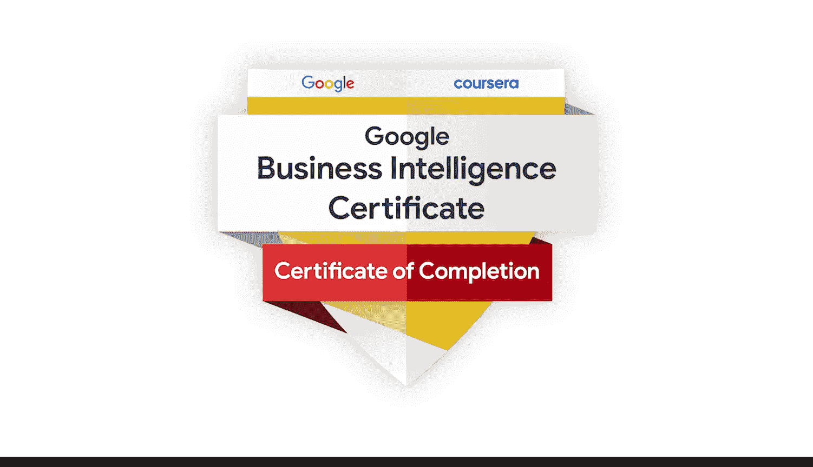

# 谷歌《谷歌商业智能（BI基础、洞察路线：模型和pipelines、决策：数据看板）｜Google Business Intelligence》 p130 51_06_01_恭喜完成谷歌商业智能证书课程.zh_en -BV1yJ4m1V7W9_p130-

It's been wonderful leading you through the final part of this program。

 I know you're well prepared for a fantastic career。

 All of us have been so happy to share this journey with you and can't wait to welcome you to the world of B I。

😊，Congratulations you've done a great job congratulations I'm so proud of you congratulations congratulations you completed program thatgratsgratulations on making it through this course've done an amazing job and I think you're for success it。

All that's left to do is collect your Google Business Intelligence Cate。

 which you can display on your resume and LinkedIn profile。

This certificate represents all the hard work you put into completing this program。

 You've accomplished a tremendous amount and shown serious dedication to the field。 So stay curious。

 After all， the learning doesn't stop here。 As you enter this new era。

 Be sure to keep up with B I trends。 Connect with colleagues。 keep updating your career materials。

 For now， take some time to celebrate your achievement。 You've earned it。😊。

