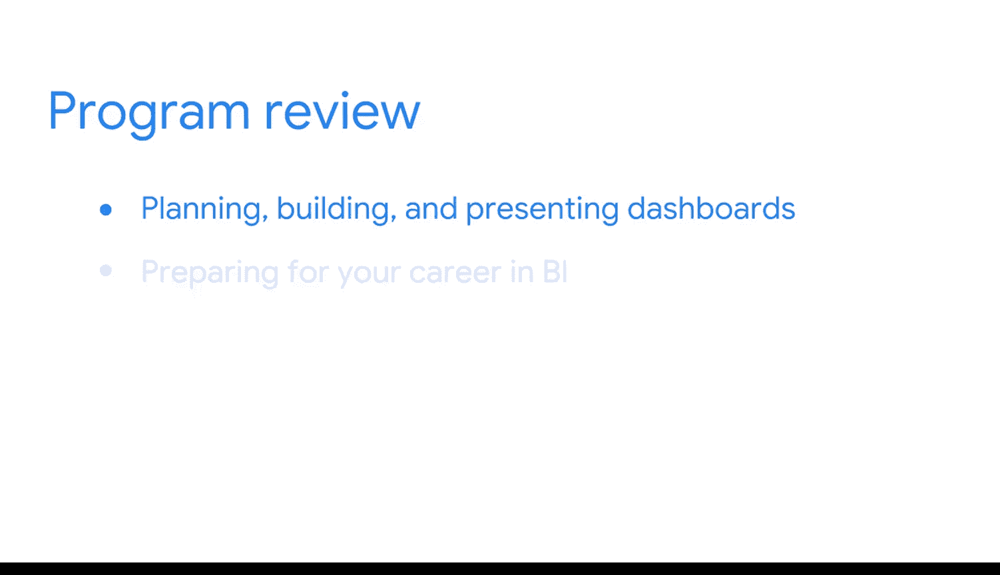

# 谷歌《谷歌商业智能（BI基础、洞察路线：模型和pipelines、决策：数据看板）｜Google Business Intelligence》 p131 52_06_05_项目总览回顾.zh_en -BV1yJ4m1V7W9_p131-

You just earned the Google Business Intelligence Career certificateer。

 This is a huge accomplishment that shows that you're invested in learning new skills for your future。

Now that you're certified in business intelligence。

 your certificate can be displayed on job search platforms such as LinkedIn Indeed and Glassdoor。

 Also， be sure to connect with companies that are eager to hire in your field through G with Google's employer consortium。

 as you learned at the beginning of this program， the demand for business intelligence professionals is growing at an incredible rate。

 with the skills and knowledge you've gained。 you can keep exploring B jobs as you work to advance your career in this high growth。

 high impact field。 Let's review all you've achieved throughout this program You started by investigating the foundations of business intelligence here。

 you discovered the roles and functions played by B professionals within an organization。

 Then you learned about B tools。 The kinds of insights they can reveal in the importance of context in B projects。

😊，In the next course， you explore data modeling and how databases are designed。

 You learned how to create pipelines to move data where it needs to go。

 And you discovered optimization techniques for databases and pipeline systems to keep your team's workflow running smoothly。

Finally， in this last course， you focused on building dashboards to monitor data over time。

 you built charts and a dashboard to answer business questions in specific scenarios。

 then learn how to present your work to stakeholders。And lastly。

 you finished your portfolio and prepared for the job interview process。

It was an incredible amount of work， and it's clear that you're ready to start an exciting and rewarding career。

 Get out there and make an impact in the world of business intelligence。😊。

