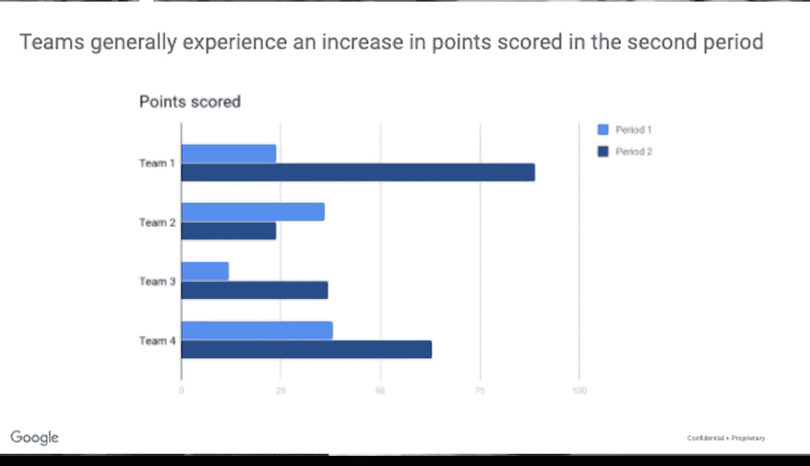

# 谷歌《谷歌商业智能（BI基础、洞察路线：模型和pipelines、决策：数据看板）｜Google Business Intelligence》 p14 14_01_01_可选复习：谷歌数据分析证书课程中关于数据的内容.zh_en -BV1yJ4m1V7W9_p14-

Now that you understand all the phases of the data lifecycl。

 it's time to move on to the phases of data analysis。 They sound similar。

 but are two different things。Data analysis isn't a life cycle。

 It's the process of analyzing data Com up， we'll look at each step of the data analysis process and how it will relate to your work as a data analyst。

Even this program is designed to follow these steps。

 understanding these connections will help guide your own analysis and your work in this program。

You've already learned that this program is modeled after the stages of the data analysis process。

 This program is split into courses，6 of which are based upon the steps of data analysis。 ask。

 prepare， process， analyze， share and act。😊，Okay， let's start with the first step in data analysis。

 the as phase。In this phase， we do two things。 We define the problem to be solved。

 and we make sure that we fully understand stakeholder expectations。

 Stakeholder hold a stake in the project。 They are people who have invested time and resources into our project and are interested in the outcome。

 Let's break that down。 First， defining a problem means you look at the current state and identify how it's different from the ideal state。

 Usually， there's an obstacle we need to get rid of。 or something wrong that needs to be fixed。😊。

For instance， a sports arena might want to reduce the time fans spend waiting in the ticket line。

 The obstacle is figuring out how to get the customers to their seats more quickly。

 Another important part of the as phase is understanding stakeholder expectations。

 The first step here is to determine who the stake are。 That may include your manager。

 an executive sponsor or your sales partners。 There can be lots of stakeholders。

But what they all have in common is that they help make decisions。

 influence actions and strategies and have specific goals they want to meet。

 They also care about the project。 And that's why it's so important to understand their expectations。

 For instance， if your manager assigned you， a data analysis project related to business risk。

 It would be smart to confirm whether they want to include all types of risks that could affect the company or just risks related to weather。

 such as hurricanes and tornadoes。 Communicating with your stakeholders is key in making sure you stay engaged and on track throughout the project。

So as a data analyst， developing strong communication strategies is very important。

 This part of the ask phase helps you keep focused on the problem itself， not just its symptoms。

 As you learned earlier， the five Ws are extremely helpful here。😊，In an upcoming course。

 you'll learn how to ask effective questions and define the problem by working with stakeholders。

You'll also cover strategies that can help you share what you discover in a way that keeps people interested。

 After that， we'll move on to the prepare step of the data analysis process。

 This is where data analysts collect and store data they'll use for the upcoming analysis process。

 You'll learn more about the different types of data and how to identify which kinds of data are most useful for solving a particular problem。

😊，You'll also discover why it's so important that your data and results are objective and unbiased。

In other words， any decisions made from your analysis should always be based on facts and be fair and impartial。

 Next is the process step。 here， data analysts find and eliminate any errors and inaccuracies that can get in the way of results。

 This usually means cleaning data， transforming it into more useful format。

Combining two or more data sets to make information more complete and removing outliers。

 which are any data points that could skew the information。 After that。

 you'll learn how to check the data you prepared to make sure it's complete and correct。

 This phase is all about getting the details right。

 So you'll also fix typos inconsistencies or missing an inaccurate data。And as to top it off。

 you'll gain strategies for verifying and sharing your data cleansing with stakeholders。

Then it's time to analyze。Analyzing the data you've collected involves using tools to transform and organize that information so that you can draw useful conclusions。

 make predictions and drive informed decision making。

 There are lots of powerful tools data analysts use in their work。 and in this course。

 you'll learn about two of them。 spreadsheets and structure query language or SQl。

 which is often pronounce SQL。 The next course is based on the share phase Here。

 you'll learn how data analysts interpret results and share them with others to help stakeholders make effective data driven decisions。

 In the share phase， visualization is a data analyst best friend。

 So this course will highlight why visualization is essential to getting others to understand what your data is telling you with the right visuals。

 facts and figures become so much easier to see and complex concepts become easier to understand。

 We'll explore different kinds of visuals in some great data visualization tools。

 You'll also practice。😊，Own presentation skills by creating compelling slideshows and learning how to be fully prepared to answer questions Then we'll take a break from the data analysis process to show you all of the really cool things you can do what the programming language are。

You don't need to be familiar with R or programming languages in general。

Just know that R is a popular tool for data manipulation， calculation， and visualization。

And for our final data analysis phase， we have Act。

 This is the exciting moment when the business takes all of the insights you， the data analyst。

 have provided and puts them to work in order to solve the original business problem and will be acting on what you've learned throughout this program。

😊，This is when you'll prepare for your job search and have the chance to complete a case study project。

It's a great opportunity for you to bring together everything you've worked on throughout this course。

 plus， adding a case study to your portfolio helps you stand out from the other candidates when you interview for your first data analyst job。

 Now， you know the different steps of the data analysis process and how our course reflects it。

 You have everything you need to understand how this course works。😊。

And my fellow Googlers and I will be here to guide you every step of the way。

