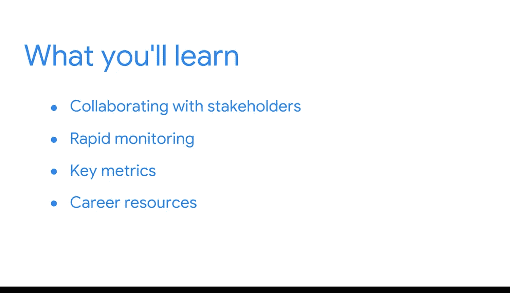

# 谷歌《谷歌商业智能（BI基础、洞察路线：模型和pipelines、决策：数据看板）｜Google Business Intelligence》 p17 17_02_01_欢迎来到模块2.zh_en -BV1yJ4m1V7W9_p17-

Welcome to the second section of the Google Business Inlig certificate。

 I'm so glad to have you joining me again。 Now that you have a solid foundation in the basics of B。

 it's time to focus on the actual B I process。 This involves learning how to effectively engage with stakeholders。

 using B I tools to make the most of available data and applying the power of rapid monitoring for smart business decisions。

😊，And one thing that connects all of these aspects of B I is asking questions。 time and time again。

 I see that the most successful people in our field are the ones who asked lots of questions。

 We ask our colleagues what's slowing them down or causing friction in a process。

 We ask about our customers， competitors and what's going on in global marketplace。

 We ask how things work。 So we can learn about different tools and technologies。

 When I was first starting out， I would ask tons of questions about the capabilities and limitations of different systems。

 Even if I didn't use these particular tools in my own day to day work。😊。

That's because just having a basic understanding enabled me to make connections to the work my team was doing and identify ways that I could make positive contributions。

😊，For instance， when I joined Google， I was learning about Google SQL platforms and the different SQL languages used。

 depending on the tools involved。 Sometimes other languages such as Python and jascript were involved。

 which I had never experienced before to familiarize myself。

 I made a point to ask questions about how these things worked and who I could go to in order to learn more。

 I encourage you to do the same thing in your own career。 And even while you pursue this certificate。

 there is a lot of information being covered。😊，In this section of the course。

 we'll first explore how to successfully collaborate with a diverse group of stakeholders。

 Then you'll discover how near real time rapid monitoring enables users to collect and report on key metrics。

 then apply them to make better decisions。😊，In addition。

 you'll start building some career resources by enhancing your online presence。

 developing strategies for networking and mentorship。

 and building a portfolio that will impress future hiring managers。

All of that starts by understanding an organization's business needs and important deliverables。

 After all， if you want to achieve your objectives， you first have to define them。Now。

 I've got a question for you。 Are you ready to get started， Let's go。

