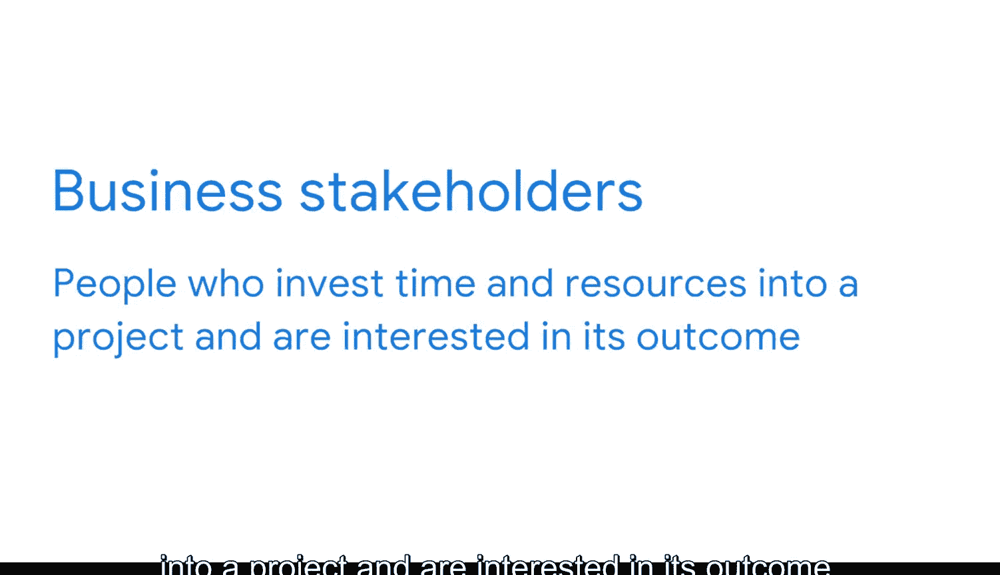

# 谷歌《谷歌商业智能（BI基础、洞察路线：模型和pipelines、决策：数据看板）｜Google Business Intelligence》 p18 18_02_02_商业智能利益相关者.zh_en -BV1yJ4m1V7W9_p18-

As you're discovering， B， I professionals are passionate about helping people do their jobs more effectively。

 In my work， I feel a huge sense of accomplishment when I know that I've saved my stakeholders time。

 Help them find a better process or show them a whole new approach。

 This enables them to focus on other tasks where they can maximize their unique strengths and interests。

 But before I can do any of that， I first have to get to know them。

 their roles and responsibilities and their business goals。 After all。

 different people require different B I insights。 But once I have that understanding。

 I can much more easily determine what a particular project is all about。

 and what my stakeholders are expecting me to deliver。

 And this is what we're going to explore now in this video。😊，As a quick refresher。

 a stakeholder is someone who invests time and resources into a project and is interested in its outcome。

 Typically， this is because they need the work you do to perform their own tasks。

 But sometimes it's the other way around。 You need them。Either way， it's all about teamwork。

 And that's why it's so critical to ensure that outputs align with the team's requirements。

Sometimes a stakeholder might be referred to as a client or user。

 but their general role is still the same。There are all sorts of stakeholders in the B I process。

 but we're going to focus on the four most common ones。 These include the project sponsor。

 the systems analyst， the developer and the business stakeholders。

Let's start with the project sponsor。 This person has overall accountability for a project and establishes the criteria for its success。

Accountability involves accounting for or being responsible for project activities。

 Project sponsors are representatives of the business side。

 which typically means they're involved when a project is being envisioned。

 and they advocate for its undertaking。And because the project sponsor is responsible for sharing events。

 changes and milestones with other stakeholders in a timely and transparent manner。

 it's important for BR professionals to always keep the project sponsor informed。 Here is an example。

 In a previous team， I worked on an initiative that involved the customer service department changing its operational platform。

The project sponsor was the director of Cloud Systems。

 She was responsible for the vision for the project。

 gathering the relevant teams together and establishing key objectives As the B I professional。

 I made sure to provider her with the information she needed to support this effort。

 such as what inputs I would need and how long it would take me to create a dashboard。

 The developers is the next stakeholder on our list。Develop use programming languages to create。

 execute tests and troubleshoot software applications。 You may hear them called computer programmers。

 coders or software engineers。 There are two primary types of developers。 A。

 software developers and systems software developers。

 apps developers design computer or mobile applications。

 because their work is largely focused on creating for consumers。

 These professionals are focused on user needs。 monitoring performance and modifying programs as needed。

😊，System software developers are more likely to be stakeholders on a VR project because they develop applications and programs for the back end processing systems used in organizations。

Going back to my example of the customer service project。

 the system software developer worked on the platform's backend settings to ensure that data flowed into data tables。

 which analysts used to determine how happy customers were with the customer service department。

Next up is the systems analyst。 This person identifies ways to design。

 implement and advance information systems in order to ensure that they help make it possible to achieve business goals。

Systems analysts study how an organization uses its computer， hardware and software。

 cloud services and related technologies。 Then they use what they learn to iterate on and improve these tools。

For instance， during the customer service project， the systems analysts work with the raw data provided by the systems software developer。

 then they organized it into data that I as a BI professional， could use for reporting purposes。

Now we've come to business stakeholders。If you're familiar with the Google data Analytic certificate。

 then you've learned a lot about these people。 Business stakeholders invest time and resources into a project and are interested in its outcome。

 Feel free to revisit that content。 If you like to review business stakeholders before moving on。

 All of the people you learn about in this video are different。

 So though all require different things from the B I process。

 The key is to always communicate proactively and prioritize teamwork。 My project was a success。

 because we were all in it together。😊。

