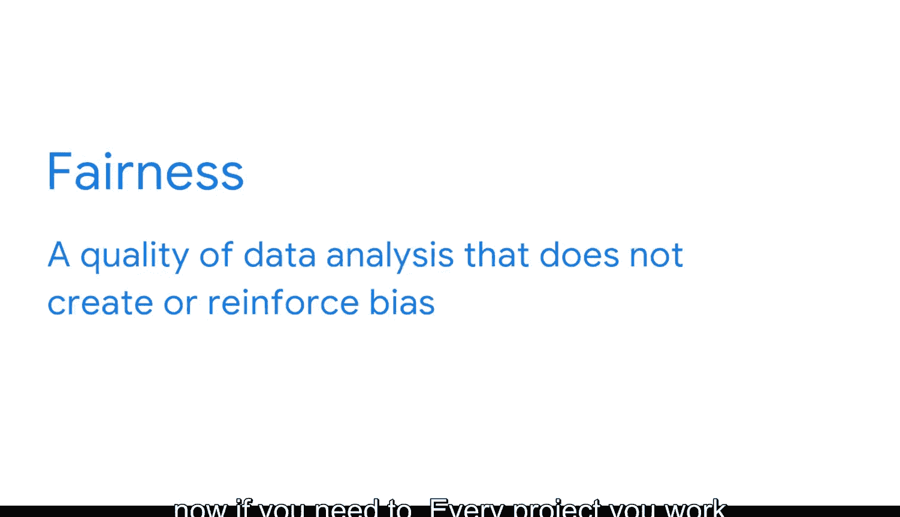

# 谷歌《谷歌商业智能（BI基础、洞察路线：模型和pipelines、决策：数据看板）｜Google Business Intelligence》 p19 19_02_04_成为卓越的商业智能沟通专家.zh_en -BV1yJ4m1V7W9_p19-

Recently， we've been exploring key elements of the business intelligence process。

 We spent some time getting to know typical BI stakeholders， including the project sponsor。

 systems analyst， developer and general business stakeholders。😊，Now。

 we're going to take that a step further and consider some important communication strategies that BI professionals use when collaborating with these people。

 These strategies involve knowing how to ask the right questions， define project deliverables。

 and effectively share the business intelligence to discover。

No BI project is 100% clear from the very beginning。

 so you'll often need to put on your detective's hat。

A critical part of being a BI professional is knowing how to investigate what's currently going on。

 then looking for clues to better understand people's needs and ideal project outcomes。

My colleagues and I often note that a stakeholder， partner or cookker might say they need one thing。

 but what they actually need is very different。And it's up to us to get to the bottom of it and help them succeed。

In such circumstances， having strong communication skills will enable you to dig deeper into the problem。

 challenge or opportunity， then identify how you can approach the issue in the most effective way。

This process starts with asking the right questions。

If you earn the Google Data Analytic certificateer。

 you spent an entire course focusing on this ask phase of the data analysis process。

As a quick refresher， this involves understanding the difference between effective and ineffective questions。

 knowing what types of questions bring about the best insights enables you to use questioning to fully understand stakeholder expectations。

 especially when what they're asking for is different from what your professional experience indicates they require。

 If you're comfortable with the ask phase， continueue to the next part of this lesson。

 Or if you like to review these principles， feel free to do so now。😊，Okay。

 after asking the right questions in order to thoroughly understand the project。

 it's time to define project deliverables。 A deliverable is any product。

 service or outcome that must be achieved in order to complete a project。😊。

This could be a new BI dashboard， a report， a completed analysis。

 documentation of a process or decision。 pretty toage anything requested by stakeholders can be deliverable。

In B I， the most common deliverables are the dashboards and reports that provide insights to users。

 When brainstorming which deliverables to produce， it's helpful to make a list of the problems to solve challenges to overcome or opportunities to maximize。

 Then think about the workflow for each business process involved。

 This helps you visualize the types of dashboards or reports that will be most productive。

 how many are necessary。 and what specific elements each of them requires。For example。

 when I'm asked to create a dashboard， I'll grab a piece of paper and start drawing example charts in a mockup。

Then I share them with the users。 This helps in two ways。 First。

 it ensures my vision of the dashboard is what they had in mind。 And second。

 it enables me to confirm for myself that it all makes sense。😊，Okay， now the final step。

 effectively sharing business intelligence。 It's important to know how to make complicated technical data more straightforward and accessible for people who are unfamiliar with the terminology and systems involved。

Being able to present intelligence in a clear and concise manner is fundamental to making sure that decision makers understand the insights and can put your recommendations into practice。

Also， at this point in the process， an essential responsibility of every BI professional is to consider bias。

 As you likely know， bias is a conscious or subconscious preference in favor or against a person。

 group of people or thing。There are many different types of bias that can affect a data related project。

 such as confirmation bias， data bias， interpretation bias and observerer bias。

 These concepts were taught in depth in the Google data Analytic certificate。

 So please review them now， if you need to。Every project you work on must start with a focus on fairness。

 which means that your work doesn't create or reinforce bias。

BI professionals have a lot of power because we're the ones translating very technical topics into a simple language for others。

 It's vital that your translation is fair。After all， your team is trusting you。

You'll continue building your communication skills all throughout this program。

 and in no time you'll be ready to thoughtfully share even the most complex BI insights。

