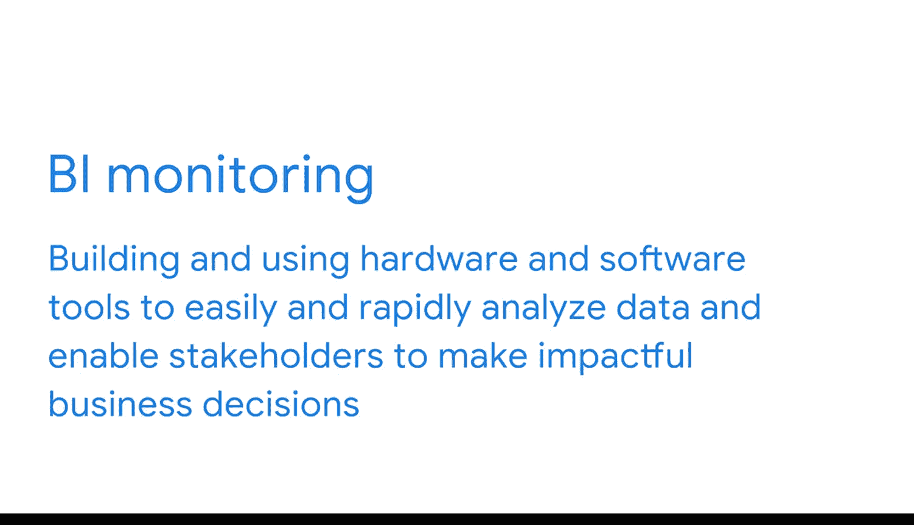

# 谷歌《谷歌商业智能（BI基础、洞察路线：模型和pipelines、决策：数据看板）｜Google Business Intelligence》 p20 20_02_01_近实时监控的价值.zh_en -BV1yJ4m1V7W9_p20-

Have you ever been shopping online and added something to your car。

 but then ultimately decided not to purchase it。I know I have。 I absolutely love cooking。

 and I like to shop online for cookbooks， Inter spices， or maybe even a new kitchen gadget。

 But sometimes I change my mind before checking out because I choose to save the money instead。

 or I decide that the kitchen tools I already have will work just fine for my recipe。

 When that happens， the online store has what's called an abandoned cart。

 And according to E-commerce platform Shopify， online merchants lose 18 billion a year in sales revenue because of card abandonment。

 This is a big problem。 But it's one that business intelligence professionals are very skilled at solving。

 And this video will consider exactly how that works。

 B I professionals can use data to identify where a customer came from。

 Whether a Google's search and email link or maybe a social media post。

 Then they can visualize the journey the shopper took when visiting the website。

 They're even able to pinpoint exactly where that customer dropped off and。😊，Try to figure out why。

 For example， a B I professional might create a tool to monitor how quickly the website checkout page is loading。

 If the team decides that it' taking too long， the company can dedicate resources to improve website speed and hopefully keep that customer in the future。

The measure of a website page loading speed is an example of a metric。

 A metric is a single quantifiable data point that is used to evaluate performance in B I。

 some of the most important metrics are Kpis， which you've learned are quantifiable values closely linked to business strategy that tracks progress towards a goal。

Many people confuse Kpis and metrics， but they are different things。

 The basic point to keep in mind is that metrics support Kpis and in turn。

 Kpis support overall business objectives。It's also helpful to understand that KPRs are strategic。

 whereas metrics are tactical。Going back to our abandoned car example。

Strong K Ps might be the average value of each online transaction。

 customer retention or year over year sales。Think of it this way。

 A strategy is a plan for achieving a goal or arriving at a desired future state。

 It involves making and carrying out plans to reach what you're trying to accomplish。

 A tactic is how you get there。 It's a method used to enable an accomplishment， including actions。

 events and activities。 Tactics take place along the way as part of your strategy to reach your final objective。

 like stepping stones between each milestone。😊，Reach enough milestones and you'll reach your goal。

Understanding business objectives and what is needed in order to achieve them is the first step in B I monitoring。

 B I monitoring involves building and using hardware and software tools to easily and rapidly analyze data and enable stakeholders to make impactful business decisions。

 So let's say our E-commerce merchant sets the goal to decrease cart abandonment by 15% in six months。

 The B I professional would create a tool that monitors web page loading speeds in order to help achieve that K P I。

Rapid monitoring means that the people using B tools are receiving live or close to live data In this way。

 key decision makers know right away if there's a steep rise in the number of abandoned carts or if they run out of inventory on a popular product。

 or if customer service representatives are receiving an unusually high volume of calls。

Knowing right away means that the company can fix whatever the problem may be as quickly as possible。

 and this is one of the main ways in which BI professionals add real value to their organizations。

Later in this course， you'll learn more about how to select appropriate metrics。 Lots more to come。

