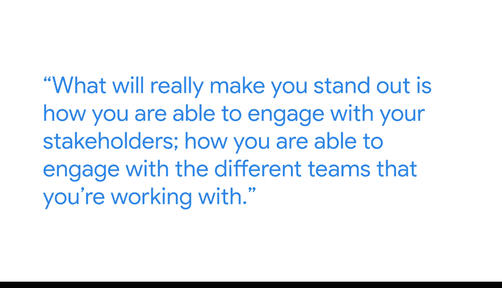

# 谷歌《谷歌商业智能（BI基础、洞察路线：模型和pipelines、决策：数据看板）｜Google Business Intelligence》 p21 21_02_03_安妮塔：我的商业智能职业路径.zh_en -BV1yJ4m1V7W9_p21-

。

Hello， I'm Anita， a business intelligence analyst at Google。

 My very first job was I was a librarian at the public library in my hometown。

 and that was a job where I was talking to people every single day。

 They had questions about where to find a book。 I need something that covers X， Y Z。

 And that really helped me learn and figure out how to talk to people who maybe have a problem and don't know how to solve it。

 but they're looking for you for help。 I think that was a huge starting point for my career in B。

 I got into B， not through a straight path。 I started off working in accounts payable and accounts receivable and helping optimize those processes for my clients。

 through working with them started to hear a lot about the need for analytics。

 And the need for understanding， I have so much data。

 But what's the important piece that comes out of this。 And so from hearing that from my clients。

 It started me down this path of okay， what tools are out there。😊。

How can I help them find those insights and that led me to one job after the another until ultimately I found myself in business intelligence。

 and I can't really imagine working in any other field。With each successive job that I've had。

 whether it be as a data analyst and accounts payable and accounts receivable or working in a collections department。

 I've picked up things for how to tell a successful story through data。

 and ultimately I think it's a little bit of what BI comes back to is what are the trends， patterns。

 insights that we're looking for that's going to tell a compelling story that let people make decisions using that information。

The one piece of advice I have for people getting into BI is really focus on your people skills and the networking the technical skills are important。

 the coding， the SQL understanding the databases and the different programs that we use is important that's how you'll do your job day to day but what will really make you stand out is how you're able to engage with your stakeholders how you're able to engage with the different teams that you're working with and how you take all of the things that you're hearing from them and eventually synthesize them into that final BI product that's going to help them get insights from their data。

I think everybody has transferable skills， every job that you've had。

 every experience that you've been through， you've learned something from it。

 and if you take a moment to think about what it is that you've learned from that。

 maybe it's your first job in high school， maybe it's an experience that you had in university where working with a group you were negotiating difficult team dynamics every single one of those is a transferable skill that you can bring into the business intelligence field。

