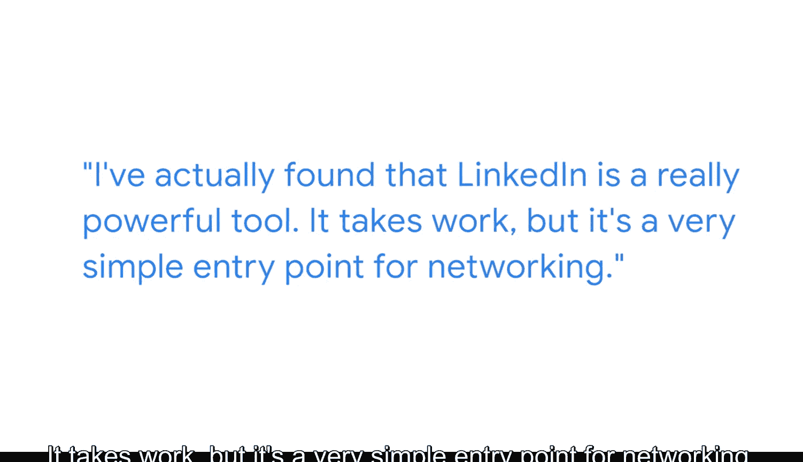

# 谷歌《谷歌商业智能（BI基础、洞察路线：模型和pipelines、决策：数据看板）｜Google Business Intelligence》 p22 22_02_05_杰罗德：导师制的非凡价值.zh_en -BV1yJ4m1V7W9_p22-

My name is Gerd and I'm a principal lead in the analytics and decision support team in YouTube。

 and our team focuses on building out business intelligence and analytics for the YouTube business organization。

 Mentorship has been a huge part of my progression in my career。 I've had the fortune of。

Many mentors over the course of my career， both at Google and outside of Google。

 some from like schooling， some just by happenstance。

 But every single one of them have given me something that。Was either a motivating factor or。

Encourage me to believe more in myself。Or。That， like。

Just were there to listen to me vent about something not working or whatever it might be。

 Look for groups that are focused on the areas that you're interested in。

 if we're thinking about B and analytics。 there's so many groups of folks who are business intelligence professionals。

 and there's niche groups that are focused on data science or predictive analytics。 I've also just。

Reached out to people， whether it is via email or。Introductions from other folks that I know LinkedIn。

 and I usually tend to look for people that are doing something that I'm interested in。

 that have a skill that I don't have。And I just reach out and say， hey， I'm。

 I'd love to have a conversation about X， Y， Z thing and hear how you think about it。

 I've actually found that LinkedIn is a really powerful tool。 It takes work。

 but it's a very simple entry point for networking。 And when I say networking。

 I don't mean just like。😊。

Small talk， I mean， actually。Reaching out to someone in the hopes that they are someone that actually wants to be reached out to。

And really being intentional about what it is you want to learn from people who have done something you want to do。

 be on yourself。Because most likely， there are not as many people who are doing the same。

 but the more you show and prove your capabilities， your sticktuness。

Whatever other adjective you can use， the more people will start to bet on you and the more opportunities that come from that。

