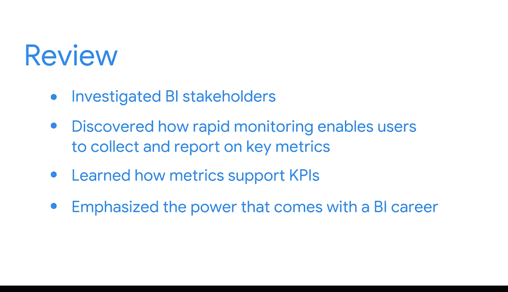

# 谷歌《谷歌商业智能（BI基础、洞察路线：模型和pipelines、决策：数据看板）｜Google Business Intelligence》 p23 23_02_01_模块总结_1.zh_en -BV1yJ4m1V7W9_p23-

Well， we've come to the end of another section。You learn about enhancing your online presence and maximizing networking and mentorship opportunities。

 You also investigated the various BI stakeholders and some proven methods for collaborating with them effectively。

 You discovered how rapid monitoring enables users to collect and report on key metrics。

 that apply them so organizations can make better decisions。😊，In addition。

 you learn about how metrics support KPIs， which in turn support business objectives。

And we emphasize the power that comes with a B I career and why it's so important to keep fairness in mind at all times。

 Your business， intelligence， knowledge and skills continue to develop and grow。

 I'm really happy to be with you on this exciting journey。 Com up。

 you have another graded assessment ahead。 to prepare。

 be sure to check out the reading that lists all of the new glossary terms you've learned。

 And as always， take any time you need to review videos。

 readings and your own notes to refresh yourself on all the content。😊。

Congrats on all of your progress。 We'll connect again shortly。😊。

