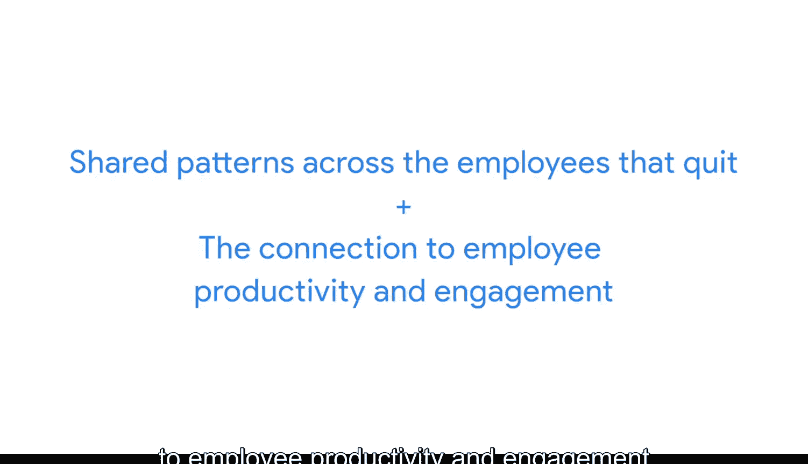

# 谷歌《谷歌商业智能（BI基础、洞察路线：模型和pipelines、决策：数据看板）｜Google Business Intelligence》 p24 24_02_01_可选复习：谷歌数据分析证书课程中关于利益相关者的内容.zh_en -BV1yJ4m1V7W9_p24-

As a data analyst， you'll be required to focus on a lot of different things and your stakeholdersholder' expectations are one of the most important we're going to talk about why stakeholder expectations are so important to your work and look at some examples of stakeholder needs on a project。

By now you've heard me use the term stakeholder a lot so let's refresh ourselves on what a stakeholder is Stholder are people that have invested time。

 interest and resources into the projects that you'll be working on as a data analyst In other words。

 they hold stakes in what you're doing there's a good chance they'll need the work you do to perform their own needs That's why it's so important to make sure your work lines up with their needs and why you need to communicate effectively with all of the stakeholders across your team。

Your stakeholders will want to discuss things like the project objective。

 what you need to reach that goal， and any challenges or concerns you have。This is a good thing。

 These conversations help build trust and confidence in your work。

Here's an example of a project with multiple team members。

 let's explore what they might need from you at different levels to reach the project goal。

Imagine you're a data analyst working with a company's human resources department。

 The company has experienced an increase in its turnover rate。

 which is the rate at which employees leave a company The company's HR department once to know why that is and they want you to help them figure out potential solutions。

 The vice president of HR at this company is interested in identifying any shared patterns across employees who quit and seeing if there's a connection to employee productivity and engagement as a data analyst is your job to focus on the HR department's question and to help find them an answer but the BP might be too busy to manage day to day tasks or might not be your direct contact for this task you'll be updating the project manager more regularly Project managers are in charge of planning and executing a project。

Part of the project manager's job is keeping the project on track and overseeing the progress of the entire team。

In most cases， you'll need to give them regular updates。

 let them know what you need to succeed and tell them if you have any problems along the way。

You might also be working with other team members， for example。

 HR administrators will need to know the metrics you're using so that they can design ways to effectively gather employee data。

 You might even be working with other data analysts who are covering different aspects of the data It's so important that you know who the stakeholders and other team members are in a project so that you can communicate with them effectively and give them what they need to move forward in their own roles on the project。

Youre all working together to give the company vital insights into this problem。

 So back to our example， by analyzing company data。

 you see a decrease in employee engagement and performance after their first 13 months at the company。

 which could mean that employees started feeling demotivated or disconnected from their work。

And then often quit a few months later。Another analyst who focuses on hiring data also shares that the company had a large increase in hiring around 18 months ago。

 you communicate this information with all your team members and stakeholders。

 and they provide feedback on how to share this information with your VP。In the end。

 your VP decides to implement an in-depth manager check in with employees who are about to hit their 12 monthth mark at the firm to identify career growth opportunities which reduces the employee turnover starting at the 13 month mark This is just one example of how you might balance needs and expectations across your team you'll find that in pretty much every project you work on as a data analyst。

 different people on your team from the VP of HR to your fellow data analyst will need all your focus and communication to carry the project to success focusing on stakeholder expectations will help you understand the goal of a project。

 communicate more effectively across your team and build trust in your work Com up。

 we'll discuss how to figure out where you fit on your team and how you can help move a project forward with focus and determination。

