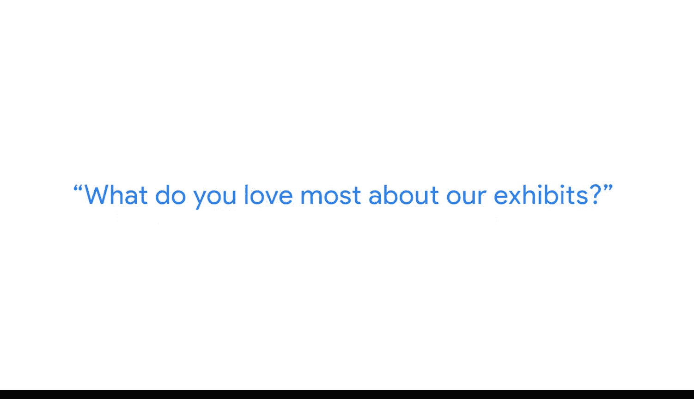

# 谷歌《谷歌商业智能（BI基础、洞察路线：模型和pipelines、决策：数据看板）｜Google Business Intelligence》 p25 25_02_02_可选复习：谷歌数据分析证书课程中关于有效提问的内容.zh_en -BV1yJ4m1V7W9_p25-

Now that we've talked about six basic problem types， it's time to start solving them to do that。

 data analysts start by asking the right questions In this video we're going to learn how to ask effective questions that lead to key insights you can use to solve all kinds of problems As a data analyst。

 I ask questions constantly it's a huge part of the job。

 If someone requests that I work on a project， I ask questions to make sure we're on the same page about the plan and the goals。

 And when I do get a result， I question it Is the data showing me something superficially。

 Is there a conflict somewhere that needs to be resolved， the more questions you ask。

 the more you learn about your data and the more powerful your insights will be at the end of the day。

😊，Some questions are more effective than others。 Let's say you're having lunch with a friend。

 and they say， these are the best sandwiches ever， aren't they。😊，Well。

 that question doesn't really give you the opportunity to share your own opinion。

 especially if you happen to disagree and didn't enjoy the sandwich very much。

 This is called a leading question because it's leading you to answer in a certain way。

Or maybe you're working on a project and you decide to interview a family member。

Say you ask your uncle， did you enjoy growing up in Malaysia。He may reply， yes。

 but you haven't learned much about his experiences there。Your question was close to ended。

 That means it can be answered with a yes or no。 These kinds of question rarely lead to valuable insights。

Now， what if someone asks you， do you prefer chocolate or vanilla？ Well。

 what are they specifically talking about， ice cream， Pudding， coffee flavoring or something else。

 What if you like chocolate ice cream， but vanilla in your coffee。

What if you don't like either flavor， That's the problem with this question。

 It's too vague and lacks context。 knowing the difference between effective and ineffective questions is essential for your future career as a data analyst。

 After all， the data analyst process starts with the ask face。

 So it's important that we ask the right questions。 Effive questions followow the smart methodology。

😊，That means they're specific， measurable， action oriented， relevant and time bound。

 Let's break that down。Specific questions are simple。

 significant and focused on a single topic or a few closely related ideas。

 This helps us collect information that's relevant to what we're investigating。

 If a question is too general， try to narrow it down by focusing on just one element， for example。

Instead of asking a close ended question， like， are kids getting enough physical activities these days。

 ask what percentage of kit achieve the recommended 60 minutes of physical activity at least five days a week。

That question is much more specific and can give you more useful information。Now。

 let's talk about measurable questions。Measurable questions can be quantified and assessed。

 an example of an unmeasurable question would be， why did our recent video go viral？Instead。

 you could ask， how many times was our video shared on social channels the first week it was posted？

That question is measurable because it lets us count the shares and arrive at a concrete number。Okay。

 now we've come to action oriented questions。 A oriented questions encourage change。

 You might remember that problem solving is about seeing the current state and figuring out how to transform it into the ideal future state Well。

 action oriented questions help you get there So rather than asking。

 how can we get customers to recycle our product packaging。You could ask。

 what design features will make our packaging easier to recycle？

This brings you answers you can act on。 All right， let's move on to relevant questions。

 relevant questions matter are important and have significance to the problem you're trying to solve。

Let's say you're working on a problem related to a threatened species of frog。 And you asked。

 why does it matter that Pine Baron's tree frog started disappearing。This is an irrelevant question。

 because the answer won't help us find a way to prevent these frogs from going extinct。

 A more relevant question would be what environmental factors changed in Durham。

 North Carolina between 1983 and 2004 that could cause pineine Bear and St frogs to disappear from the Sand Hills region。

😊，This question would give us answers we can use to help solve our problem。

That's also a great example for our final point。 time bound questions。

 time bound questions specify the time to be studied。

 The time period we want to study is 1983 to 2004。 This limits the range of possibilities and enables the data analyst to focus on relevant data。

😊，Okay， now that you have a general understanding of smart questions。

 there's something else that's very important to keep in mind when crafting questions， fairness。

 we've touched on fairness before， but as a quick reminder。

 fairness means ensuring that your questions， don't create or reinforce bias to talk about this。

 Let's go back to a sandwich example。There， we had an unfair question because it was phrased to lead you toward a certain answer。

 This made it difficult to answer honestly， if you disagreed about the sandwich quality。

Another common example of an unfair question is one that makes assumptions， for instance。

 let's say a satisfaction survey is given to people who visit a science museum。If the survey asks。

 what do you love most about our exhibits， this assumes that the customer loves the exhibits。

 which may or may not be true。 Fairairness also means crafting questions that make sense to everyone。

 It's important for questions to be clear and have a straightforward wording that anyone can easily understand。

 Unair questions also can make your job as a data analyst more difficult。

 They lead to unreliable feedback and missed opportunities to gain some truly valuable insights。😊。

You've learned a lot about how to craft effective questions。

 like how to use the smart framework while creating your questions and how to ensure that your questions are fair and objective。

Moving forward， you'll explore different types of data and learn how each is used to guide business decisions。

 You'll also learn more about visualizations and how metrics or measures can help create success。

 It's going to be great。😊。