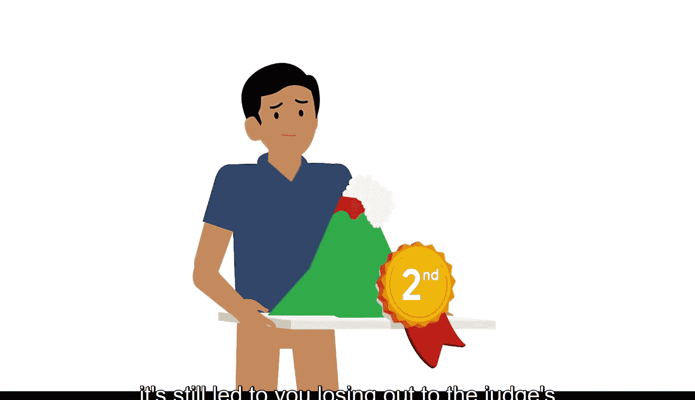

# 谷歌《谷歌商业智能（BI基础、洞察路线：模型和pipelines、决策：数据看板）｜Google Business Intelligence》 p26 26_02_03_可选复习：谷歌数据分析证书课程中关于认知偏差的内容.zh_en -BV1yJ4m1V7W9_p26-

Let's kick things off by travelling back in time。 Well， in our minds。

 at least my real time machines in the shop。 imagine you're back in middle school and you've entered a project for the science fair。

 You worked hard for weeks perfecting every element and they're about to announce the winners。

 You close your eyes。 Take a deep breath。 and you hear them call your name for second place。 Bummer。

 You really wanted that first place trophy， But， hey， you'll take the ribbon for recognition。

 The next day you learn the judge was the winner's uncle， How is that fair。

 Can he really be expected to choose a winner fairly when his own family member is one of the contestants。

 He's probably biased。 Well， maybe his niece deserved to win and maybe not。 But the point is。

 it's very easy to make a case for bias in that scenario。😊，Now， this is a super simple example。

 But the truth is， we run into bias all the time in everyday life。

 Our brains are biologically designed to streamline thinking and make quick judgments。

 biasas has evolved to become a preference in favor of or against a person， group of people or thing。

 and it can be conscious or subconscious。 The good news is once we know and accept that we have bias。

 We can start to recognize our own patterns of thinking and learn how to manage it。

 It's important to know that bias can also find its way into the world of data。

 Data bias is a type of error that systematically skews results in a certain direction。😊。

Maybe the questions on a survey had a particular slant to influence answers。

 or maybe the sample group wasn't truly representative of the population being studied， for example。

 if you're going to take the median age of the US patient population with health insurance。

 you wouldn't just use a sample of Medicare patients who are 65 and older。

Biaas can also happen if a sample group lacks inclusivity。For example。

 people with disabilities tend to be under identified。

 underrepresented or excluded in mainstream health research。

 the way you collect data can also bias a data set。 For example。

 if you give people only a short time to answer questions。

 their responses will be rushed when we're rushed， we make more mistakes which can affect the quality of our data and create biased outcomes。

As a data analyst， you have to think about bias and fairness from the moment you start collecting data to the time you present your conclusions After all。

 those conclusions can have serious implications Think about this。

 it's been acknowledged that clinical studies of heart health tend to include a lot more men than women。

This has LED to women failing to recognize symptoms and ultimately having their heart conditions go undetected and untreated。

 That's just one way bias can have a very real impact。

While we've come a long way in recognizing bias， it' still led to you losing out to the judge's niece at that science competition。

And it's still influencing business decisions， healthcare choices and access， governmental action。

 and more。 so we've still got work to do Com up we'll show you how to identify bias in the data itself and explore some scenarios when you may actually benefit from it。

