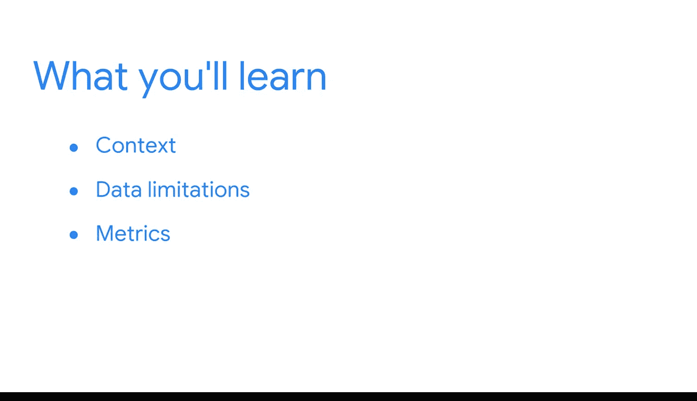

# 谷歌《谷歌商业智能（BI基础、洞察路线：模型和pipelines、决策：数据看板）｜Google Business Intelligence》 p28 28_03_01_欢迎来到模块3.zh_en -BV1yJ4m1V7W9_p28-

Hello， you're about to embark on another section of the Google Business intelligence certificate。

 This is wonderful。 You're really seizing the day。 Seize the day or Carpendim is a famous Latin phrase by the Roman poet Horace。

 He used it to express the idea that we should enjoy life while we can。

 Maybe even taking some risks in order to live life to the fullest。😊，More recently， the acronym Yolo。

 or you only live once， is a common way of expressing the same idea。Interestingly。

 the original phrase you only live once was intended to send a completely different message。

The earliest instances of such quotes in English literature were actually more of a warning。

 Their connotation was that life is precious， so we should use good judgment。

 be careful and protect ourselves from risk of harm。😊。

This is a great example of a well known concept being taken out of context。

 but lots of other things can get taken out of context， too， including data。As a refresher。

 context is the condition in which something exists or happens。

 If you earned your Google data Analytic certificate。

 you learned a lot about context and how it helps turn raw data into meaningful information。

If you'd like to review those lessons， please go ahead and do so before moving on to the next video。

It's very important for B I professionals to contextualize our data。

 This gives it an important perspective and reduces the chances of it being biased or unfair。

 During the next few lessons， we will re examineamine context from a B I context。

Then we'll move on to some other data limitations， including constant change and being able to see the big picture in a timely manner。

 I'll also share some strategies B I professionals use to anticipate and overcome these limitations。

 and we'll learn more about metrics and how they relate to context。😊。

There's much to come。 So let's seize the day and continue our business intelligence adventure。😊。

