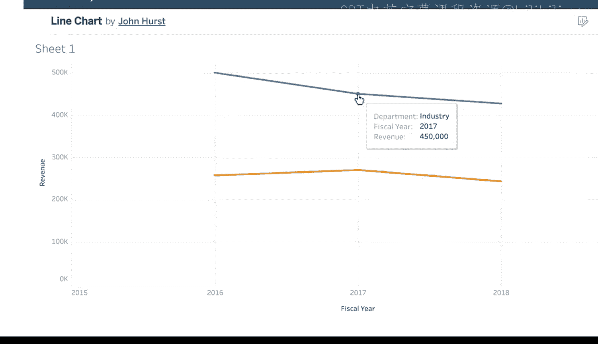

# 谷歌《谷歌商业智能（BI基础、洞察路线：模型和pipelines、决策：数据看板）｜Google Business Intelligence》 p29 29_03_02_重新审视情境分析的重要性.zh_en -BV1yJ4m1V7W9_p29-

Let's try a little experiment。 Think about what might happen if you showed this line chart to three different people。

 You'd very likely get three different interpretations。

 Even if they understood that line charts are used to show change over time。

 One person might assume the X axis represents a few days。

 While another might guess is showing a span of many years。

 Maybe one person would assume the five colored lines along the y axis represent the sales of different products。

 Another may suppose they represent the purchase patterns of different customer types。

 The point is a line chart with the title a legend for the X axis and the y axis and each of the data values it contains is a much more effective data visualization。

 When you clearly indicate the meaning of each item by giving them context， Sudden。

 this line chart can be easily understood by others。

Context helps eliminate the risk of misinterpretation。

 This saves your stakeholders time and ensures they have accurate information to make data drivenrin business decisions。

 As you likely know， in data analytics， context turns raw data into meaningful information。

 When you contextualize， you put something into perspective。

 This involves considering its origin and other relevant background information。

 the motivation behind it， the larger setting in which exists such as a particular time period。

 and what it might have an impact on contextualization gives something greater meaning to help people understand it more completely。

 This also supports fairness and reduces the chance of bias when your users seek to gain useful insights from the data you're presenting。

 which brings me to context in a B setting。In B， there's another aspect of context that professionals care about a lot。

 And that's contextualizing the tools we create for our users。

 One key practice that promotes context is to put the data being shared in central location。

 Typically， this would be a well designed dashboard。

 Then the second step is ensuring there is a common method for everyone to interact with that dashboard。

 It's important for stakeholders to be able to easily understand access and use a dashboards you create。

 This way， people don't have to go elsewhere or switch context in order to find the information they need。

 And that empowers all users to be much more effective in their work。 For example。

 let's say a company's finance team needs a dashboard to analyze costs across the entire company。

 So you design a dashboard that shares key insights about each department's particular spending。😊。

But then what if it turns out that the operation department's costs are revealed to be unusually high。

 The finance team would want to be able to take a deep dive into that department's spending in order to figure out the root causes of the cost increase。

 So it would be important to iterate on your dashboard。

 So it includes supporting information about each department as well。

Another part of building an effective solution is prioritizing the cross functional relationships that exist within your organization。

It's necessary to consider how the BI work you're doing aligns with overall business objectives and how it will be used by your colleagues。

 For instance， if your new BI tool will monitor five different metrics and be used by 10 different stakeholders。

 It's important to consider how each user will access and interpret the data。

 Basically to make an effective dashboard， it's necessary to first understand how each particular stakeholder will actually use it。

And by taking the time to think this through， you ensure that you create one robust dashboard rather than many less effective ones。

Yeah。Also， because you've created a single accessible share dashboard。

 This allows for some great collaboration among users。 For instance。

 that finance team member may be dismayed by a seemingly small，5% year over year growth number。

 But the salesperson can put that number into context。

 by pointing out that 5% is actually a good result and higher than expected。

 Given that the market segment as a whole was experiencing a 10% decline。

 The salesperson can provide that specific market context。

 whereas the financial analyst would likely only be aware of broad industry trends。😊。

A single dashboard output can bring about countless insightful conversations。

 Expressing results contextually helps you confirm that you're using the right data for the stakeholders。

 You'll also know that it's in the correct format， it can be effectively used and shared。

 and the results makes sense。 This boosts people understanding。 And as a result。

 the ultimate business benefits。😊。