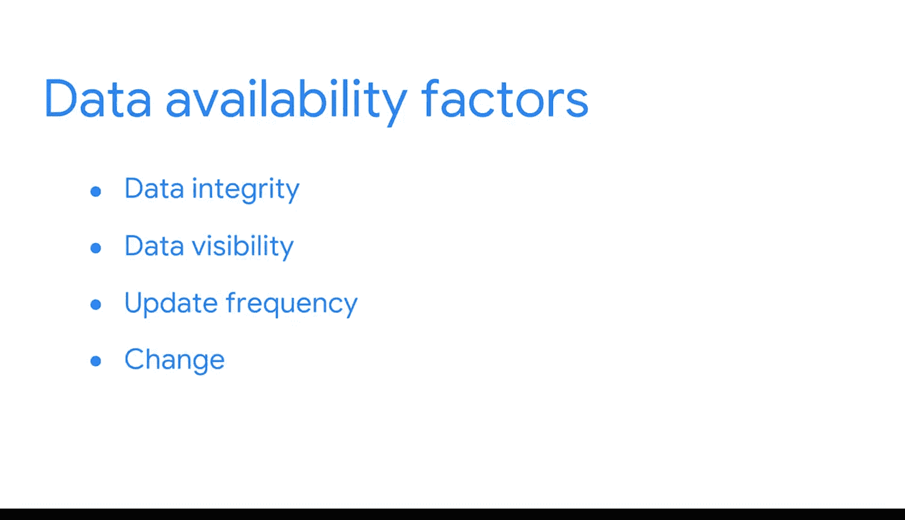

# 谷歌《谷歌商业智能（BI基础、洞察路线：模型和pipelines、决策：数据看板）｜Google Business Intelligence》 p30 30_03_04_瞬息万变世界中的数据可用性.zh_en -BV1yJ4m1V7W9_p30-

In a previous lesson， you were introduced to some of the solutions in the business intelligence Profal toolbox。

 They include data models， pipelines such as ETL， data visualizations and dashboards。

These are all powerful and exciting solutions， but only if they have relevant， timely。

 consistent and biased free data to work with。😊，This concept is known as data availability。

Data availability describes the degree or extent to which timely and relevant information is readily accessible and able to be put to use。

Unfortunately， there are various factors that can affect data availability and therefore can compromise the integrity of B I solutions。

 In this video， we're going to discuss some of those challenges， as well as ways to address them。

First， some of the most common data availability issues involve integrity。

If you earned your Google data Analytic certificate。

 you know that data integrity involves the accuracy， completeness， consistency。

 and trustworthiness of data throughout its entire life cycle。

Typical issues related to data integrity include duplicates， missing information。

 inconsistent structure or not conforming to business rules。

 If you'd like to revisit the lesson about data integrity， feel free to do that now。

Then come back to this video when you're ready。The second data availability challenge has to do with visibility。

 Data visibility is a degree or extent to which information can be identified。

 monitored and integrated from disparate， internal and external sources。For instance。

 employees working in a company's operations department might have no idea what data is stored in the communications department。

Or someone working in the logistics unit might have data files that contain lots of great information。

But no one else even knows they exist。Now， on the other hand， when you do have clear data visibility。

 it's possible to achieve accurate and timely insights and really improve your organization's responsiveness and agility。

To achieve these goals， B I professionals will often work with their colleagues to create a list of data repositories for stakeholders。

 You can request a short interview with the data owners or ask people to complete a quick online survey about the data they collect and use。

 This is a simple but very useful exercise to discover the kind of data that is available。 Also。

 keep in mind， data visibility challenges don't just exist within a company's four walls。

 Sometimes B I professionals are unaware of very useful external data。😊，As you may know。

 there are countless free public data sets， including government research， climate。

 energy and healthcare studies， industry surveys， and lots more。

All of these can contribute to a successful BI project。

The third data availability factor to be aware of is update frequency。 Oftentimes。

 B projects will involve multiple data sources。 It's very common for disparate sources to refresh at different times。

 such as weekly versus monthly。 Let's say a business intelligence professional works for a pet supply manufacturer based in Brazil。

And maybe they analyze product sales volume by city。

 If a retail partner moves from Vio de Janeiro to Sao Paulo in the middle of July。

 all of that month's sales would fall into Rio simply because the partner's address hasn't been updated yet in the B I system。

So either the retailer's data needs to refresh sooner to match sales data or the manufacturer should look at all data on a monthly basis。

 This is why it's important for the BI professional to understand how the update frequency of different data sources can affect insights。

 even if individual data sources are perfect， the integration aspect is often pretty messy。😊，Now。

 we've come to a fourth data availability challenge。 change。

 Change is a constant in pretty much every aspect of our lives， and data is no different。

Data availability may be affected because of a change to internal procedures。

 such as a system update or a new record keeping process。

 It may change externally because of a user interface upgrade or an adjustment to a particular algorithm。

To address this issue， BI professionals must have a plan for how they will keep stakeholders up to date on changes that might affect the project。

So they should encourage team members to think about what tools or methods they're using now。

 what could change， and how it may influence the data being tracked and how to fill any potential gaps。

Data availability is an important consideration in the field of B。

 and you're likely to spend a fair amount of time working to address data availability factors。

 This video provides an introduction to some of the most common issues you'll encounter。

 But there are other things that can affect the availability of data。 Therefore。

 it's important to be realistic about the level of quality you're aiming for。 for many projects。

 good enough is sufficient。 Just be sure to acknowledge the limitations and constraints。

 If you take that approach。 As with so many things， it's difficult， if not impossible。

 to achieve perfection。 and that's okay。

