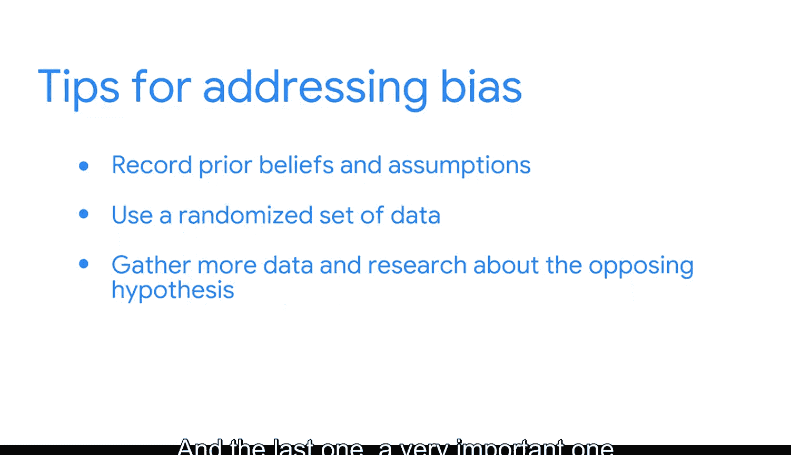

# 谷歌《谷歌商业智能（BI基础、洞察路线：模型和pipelines、决策：数据看板）｜Google Business Intelligence》 p31 31_03_07_梅格娜：警惕数据偏见.zh_en -BV1yJ4m1V7W9_p31-

My name is Mena and I'm a business intelligence analyst There are several types of biases that analyst can deal with in regular life。

 confirmation bias， selection bias， historical bias and outlier bias confirmation bias occurs when an analyst is either exploring or trying to interpret data to confirm with their prior beliefs。

This can happen at any stage of data analysis while gathering data for analysis。

 while actually doing exploratory analysis or while interpreting the data。

 selection bias can occur when we are dealing with samples which are not representative of the entire population。

 This can happen organically， when we are dealing with small data sets or when the randomization process has not happened。

 historical data bias happens when sociocultural prejudices and beliefs are mirrored into systematic processes。

 For example， if manual systems， give poor credit ratings to a specific group of people and an analyst uses this data to feed into automated systems。

 this automatic systems is now going to either amplify or actually mirror these prejudices into the results。

 Finally talking about outlier bias。Averages are a great way to hide anomalies and outliers while skewing our observation。

😊，Data integrity practices are very important to avoid bias in data there are few tips or things that have worked for me while I've done my analysis and tried to avoid bias。

First one is record all my prior beliefs and assumptions before I start my analysis to actually be cognizant of the fact that I do have these preconceived notions about the data or the process。

 Second is to use a highly randomized set of data to actually use data which might be more representative of the analysis than being just convenient。

 Third one is to gather more data and do more research about the opposite side of your hypothesis so that you are not really ignoring that part or you're not really focusing on the thing that you believe should be the outcome of your analysis。

 and the last one a very important one is to be cognizant of outliers when the average analysis as things are looking good in the data。

 I think it is time to dig more into the data to understand nuances。

