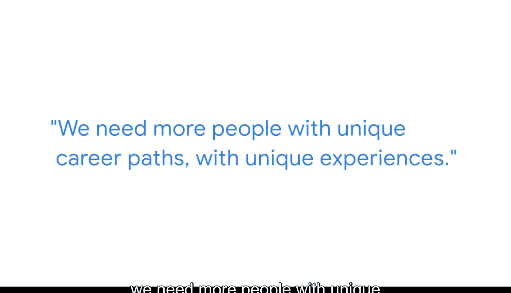

# 谷歌《谷歌商业智能（BI基础、洞察路线：模型和pipelines、决策：数据看板）｜Google Business Intelligence》 p36 36_04_02_帕特里克：成为首选候选人.zh_en -BV1yJ4m1V7W9_p36-

I'm Patrick Lau， I'm a business intelligence manager in Google Legal I manage a team of five analysts and we work on dashboards reports。

 queries for all of the Google legal team I started out at Google in a non-technical role I actually started the legal assistant and the legal department I got a lot of opportunities in my first role to work with data because data was everywhere we needed reports to report on data to visualize data and。

That opportunity gave me a lot of chances to develop my skills and start presenting data and dashboards。

At Google， I've conducted about 40 interviews， all four BI analyst roles。

Usually what I'm looking for are candidates who are really strong with their business judgment。

 who are able to make a recommendation， to find solutions and leverage data to do that。

As a hiring manager， I see a lot of resumes and sometimes they start to look alike what I really get excited about though is when a candidate includes a portfolio and not a lot of applicants include a portfolio。

What makes me excited about seeing a portfolio is looking beyond just a one page resume and seeing what kind of work they can do。

 the kind of passions they have with data kind of really just to hear their voice。

 that's what really helps me get to know a candidate。

The portfolios that I really like to see aren't just a suite of dashboards。

 I actually really like to see a video maybe on YouTube or recorded on know any other video platform because that lets me see a story from beginning to end I really enjoy seeing their slides or seeing them walk through a dashboard。

 clicking on different widgets， showing how their are trends telling a story like this really helps me get engaged。

 I find those kinds of portfolios a lot more interesting than just hey here's a bunch of links they'll click on it they'll look at it yourself for candidates creating a portfolio for the first time I really recommend keeping it simple。

 assume the hiring manager is only going to spend a few minutes looking through your dashboard or reports or queries think about the message you want them to walk away with。

The actions or recommendations you have should really stand out very quickly and very clearly。

 don't think too much about impressing a hiring manager really what's important for me is seeing the recommendation you make how you want to influence the business with your data。

As a hiring manager， I would say I really want everyone to succeed， I want you to succeed。

 you belong in the BI industry， we need you， we need more people with unique career paths with unique experiences。

 that's how we build a more diverse industry， that's how we can really increase our skills and innovate。

