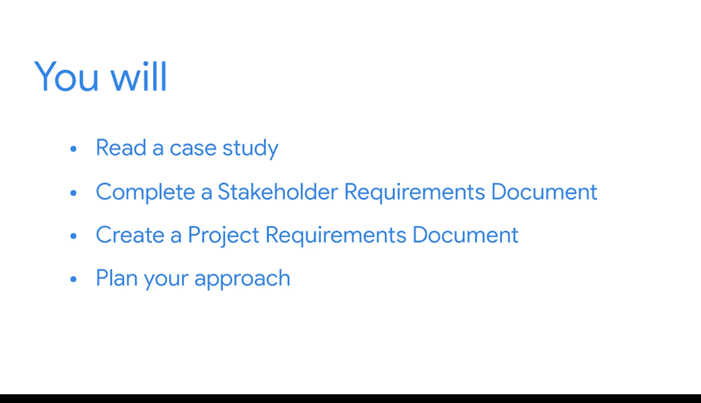

# 谷歌《谷歌商业智能（BI基础、洞察路线：模型和pipelines、决策：数据看板）｜Google Business Intelligence》 p37 37_04_03_期末项目介绍.zh_en -BV1yJ4m1V7W9_p37-

When candidates interview for jobs here at Google， my colleagues and people operations and human resources love checking out their online portfolios。

 They often feel more confident in candidates who can demonstrate their knowledge in a clear and compelling format。

 and when they review portfolios by people who want to join teams such as mine and business intelligence。

 dashashboards are particularly helpful because they are visually compelling but also straightforward and easy to use and understand。

😊，So together with the hiring managers， we look for both content and how the dash is organized in design to understand how much thought has been put into the user experience。

 Having a portfolio has become extremely common in the business intelligence field。

 During a job hunt， it is so valuable to showcase your knowledge of B。

 Your experience with the B toolbox， and some of the interesting projects that you've worked on。

 your portfolio can really help you stand out from other candidates so far in this course。

 you've gained lots of knowledge and job ready skills to help you succeed in B。

 You've discovered the role of B professionals within an organization as well as typical career paths。

 You've explored core B practices and tools and witnessed how B professionals use them to make a positive impact。

😊，All of these things will help you successfully complete your end of course project。 In addition。

 you will apply what you've learned about team members， stakeholders and clients。

 such as their particular roles or priorities。😊，Along the way。

 you'll ensure the metrics you select are relevant and effective。

And you'll apply what you now know about defining a strategy and gathering stakeholder and project requirements。

You will begin by reading about the specific case study。

 This reading will explain the type of organization you are working with， the people involved。

 the business problem to be solved and other key details。

You will complete a stakeholder requirements document using information provided by your client。

 This will enable you to further define the business problem。

 Understand the stakeholders and consider important questions to answer in order to achieve a successful result。

Then you will create a project requirements document with information about the project's purpose。

 key dependencies， success criteria， and more。Finally。

 you will thoughtfully plan your approach the example situation so you are prepared to develop an effective solution。

As you learned， the project requirements document includes the project's purpose。

 its audience and key dashboard features and requirements。

 including metrics and charts that the dash should contain。

Then in later courses， you will continue working on your end of course project。

 And by the time you're done， you will have designed something that you can use to really。

 really impress hiring managers。 Plus， you'll have a BI process document that demonstrates your thought process。

 your approach to the business problem and the key skills you've gained and lots more。

 These are all great things to talk about during an interview。😊，All right， let's get started。

 it's time to discover how you will help an organization advance through the exciting world of business intelligence。

