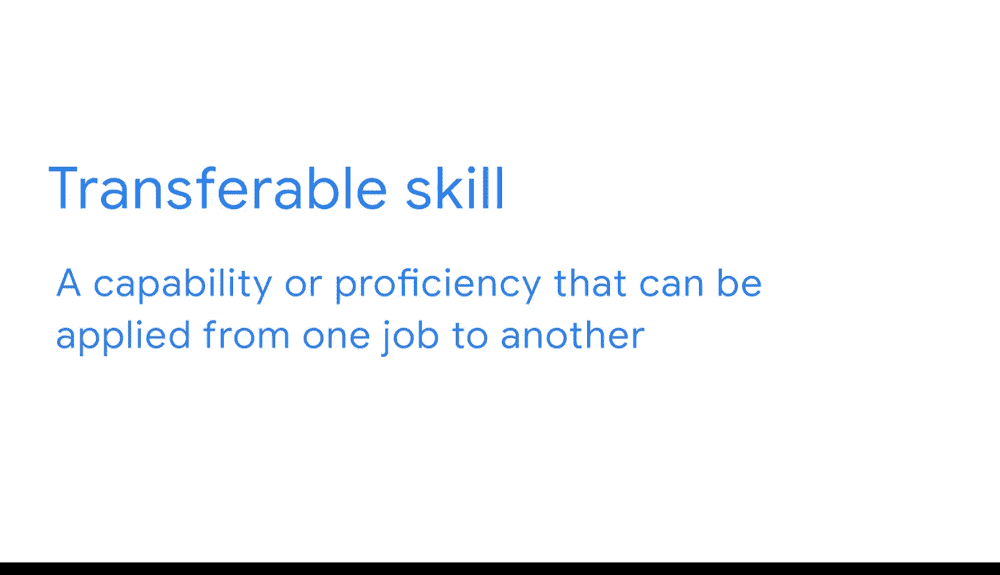

# 谷歌《谷歌商业智能（BI基础、洞察路线：模型和pipelines、决策：数据看板）｜Google Business Intelligence》 p38 38_04_01_期末项目评审.zh_en -BV1yJ4m1V7W9_p38-

You've completed the first part of the business intelligence End of course project。 Congratulations。

 Planning and documenting your approach to the example situation is a valuable experience as you begin thinking about your future job hunt。

 So， you'll be able to impress hiring managers by discussing your B experience。

 including understanding stakeholder requests， establishing a clear and straightforward project plan。

 and completing an effective strategy document。 In addition。

 you'll understand how to share everything you know about identifying relevant metrics and Kpis。

 This is a big part of the B process。 Also， as you've learned。

 it's super helpful to communicate about your transferable skills with potential employers。

 The information you've added to your B notes will be extremely useful during job interviews。

 The following step in your end of course project will come at the end of the next course。

 At that point， you will use the assets you developed here in order to continue creating your solution。

😊。

Then at the end of the program， you'll bring everything together in order to finalize your unique approach to this example situation。

 Keep in mind， your documents won't look exactly like the exemplar。

 but they should achieve the same goals。 You're always welcome to go back and review what you created。

 So you're set up for success as you continue through this program。

 The goal is to have a great example of your work that clearly demonstrates to potential employers just how skilled you are。

😊，Congratulations again， and I hope you have a rewarding experience as you work on the project throughout this program。

😊。