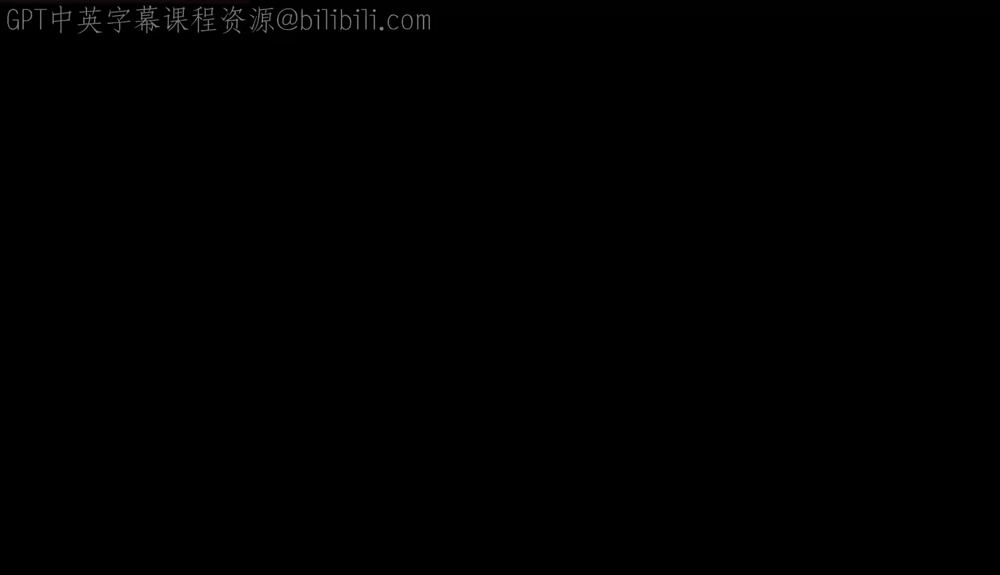
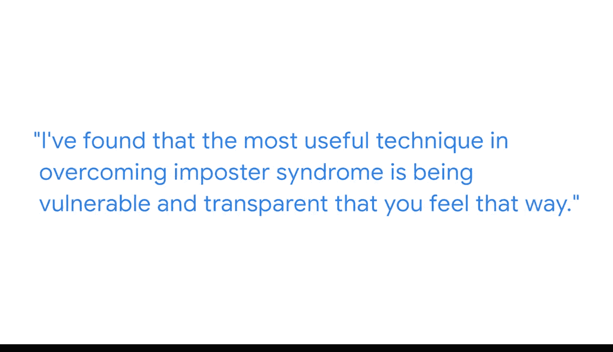

# 谷歌《谷歌商业智能（BI基础、洞察路线：模型和pipelines、决策：数据看板）｜Google Business Intelligence》 p41 02_01_03_艾德：克服冒名顶替综合征.zh_en -BV1yJ4m1V7W9_p41-

Hi， I'm Ed。 I'm a product manager at Google。As a product manager。

 I define the vision for a product and make sure that it aligns with what users actually need that product to do for them。

 For me， imposter syndrome is a belief that you are not where you need to be in terms of your skill。

 your perspectives， background or your experience。 I've definitely experienced imposter syndrome。

I work with a lot of people who are very， very skilled in their areas of expertise and not everyone can have every single skill across the board。

 So you end up thinking， oh， maybe I should be able to you program like her or maybe I should be as good data scientists as him and maybe I should have this level of perspective as it seems like everyone around me does as well。

 And that's not necessarily true。 I really think it's important to focus on the unique perspective that you provide because everyone's perspective and expertise and interests。

 and the way in which they're going to apply all of those， they're all going to differ。

 And so there are unique combinations of things that you provide that other people cannot provide simply by virtue of the fact that you are you。

 I found that the most useful technique in overcoming imposter syndrome is being vulnerable and transparent that you feel that way。

 Find people that you trust， find people that you can speak with and tell them。😊。

How you're feeling， Tell them why you're feeling that way。

 feeling a certain way doesn't have to be an indication of who you are or what you're capable of simply is and being able to be vulnerable and say。

 hey， I don't understand this or I would like a little bit of extra information that can be helpful not only for you but also for people around you we tend to focus on the negatives。

 we tend to focus on the challenges or the constructive aspects that we might see that we need to improve on while not giving ourselves enough credit for the things that we do well。

 the things that are strengths that we should lean more into。

 you're going to be more successful by understanding and really leaning into your strengths that simply trying to hide or run away from your failures。

