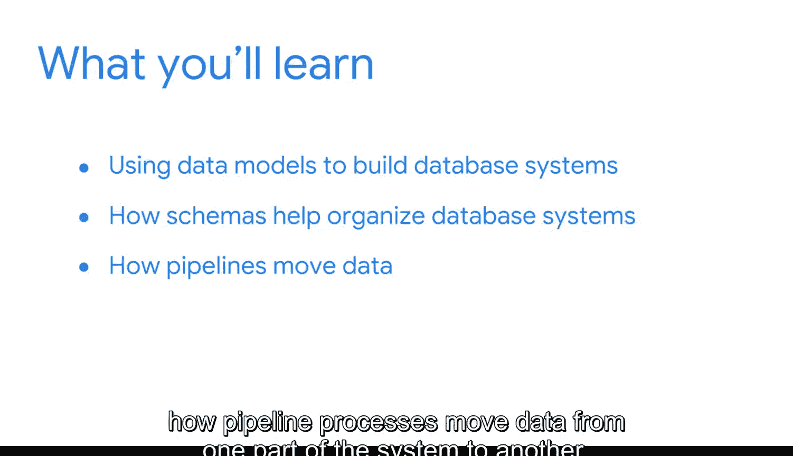

# 谷歌《谷歌商业智能（BI基础、洞察路线：模型和pipelines、决策：数据看板）｜Google Business Intelligence》 p42 03_01_05_欢迎来到模块1.zh_en -BV1yJ4m1V7W9_p42-

Welcome to the first section of this course。You're going to learn about how BI professionals use data models to help them build database systems。

 how schemas help professionals understand and organize those systems。

 and how pipeline processes move data from one part of the system to another。

We'll start by exploring data modeling foundations。

 as well as common schemas and key database elements。

We'll also consider how business needs determine the kinds of database systems that a BI professional might implement。

 will then shift to pipelines and ETL processes， which are the tools that move data throughout the system and make sure it's accessible and useful。

By the time you're done， you will have added many more important tools to your B I toolbox。

 Let's get started。