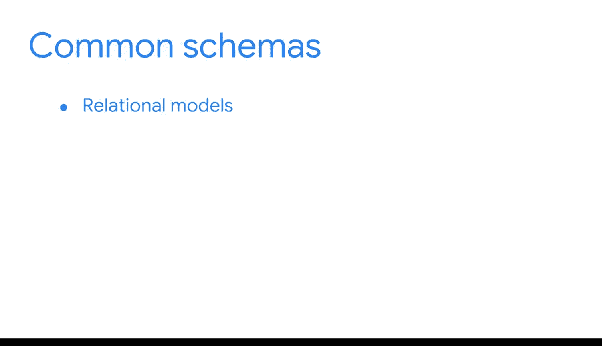

# 谷歌《谷歌商业智能（BI基础、洞察路线：模型和pipelines、决策：数据看板）｜Google Business Intelligence》 p43 04_01_01_数据建模、设计模式与架构.zh_en -BV1yJ4m1V7W9_p43-

In this video， we're going to explore data modeling， design patterns and schemas。

If you've been working with databases or if you're coming from the Google Data Analytic certificateer。

 you may be familiar with data modeling as a way to think about organizing data。

 maybe you're even already using schemas to understand how databases are designed。As you've learned。

 a database is a collection of data stored in a computer system。In order to make databases useful。

 the data has to be organized。This includes both source systems from which data is ingested and moved and the destination database where it will be acted upon。

These source systems could include data lakes， which are database systems that store large amounts of raw data in its original format until it's needed。

Another type of source system is an online transaction processing or OLTP database。

An OLTP database is one that has been optimized for data processing instead of analysis。

One type of destination system is a data Mart， which is a subject oriented database that can be a subset of a larger data warehouse。

Another possibility is using an online analytical processing or OL A database。

This is a tool that has been optimized for analysis in addition to processing and can analyze data from multiple databases。

You will learn more about these things later。But for now。

 just understand that a big part of a BI professional's responsibility is to create the destination database model。

Then you'll organize the systems， tools， and storage accordingly。

 including designing how the data is organized and stored。

These systems all play a part in the tools you'll be building later on。

 so they're important foundations for key BI processes。When it comes to organization。

 you likely know there are two types of data unstructured and structured。

Unstructured data is not organized in any easily identifiable manner。

Structure data has been organized in a certain format， such as rows and columns。

If you'd like to revisit different data types， take a moment to review this information from the data Analy certificate。

Now， it can be tricky to understand structure， so this is where data modeling comes in。

As you learned previously， a data model is a tool for organizing data elements and how they relate to one another。

These are conceptual models that help keep data consistent across a system。

This means they give us an idea of how the data is organized in theory。

Think back to Fernnaace's perfect train of business intelligence。

A data model is like a map of that train system。It helps you navigate the database by giving you directions through the system。

Data modeling is a process of creating these tools。In order to create the data model。

 BI professionals will often use what is referred to as a design pattern。

A design pattern is a solution that uses relevant measures and facts to create a model to support business needs。

Think of it like a reusable problem solving template。

 which may be applied to many different scenarios。You may be more familiar with the output of the design pattern。

 a database schema。As a refresher， a schema is a way of describing how something such as data is organized。

You may have encountered schemas before while working with databases。For example。

 some common schemas you might be familiar with include relational models， star schemas。

 snowflake schemas， and no SQL schemas。

These different schemas enable us to describe the model being used to organize the data。

 If the design pattern is the template for the data model。

 then the schema is the summary of that model。 because B I professionals play such an important role in creating these systems。

 Understanding data modeling is an essential part of the job。Coming up。

 you're going to learn more about how design patterns and schemas are used in BI and get a chance to practice data modeling yourself。

Byy for now。

