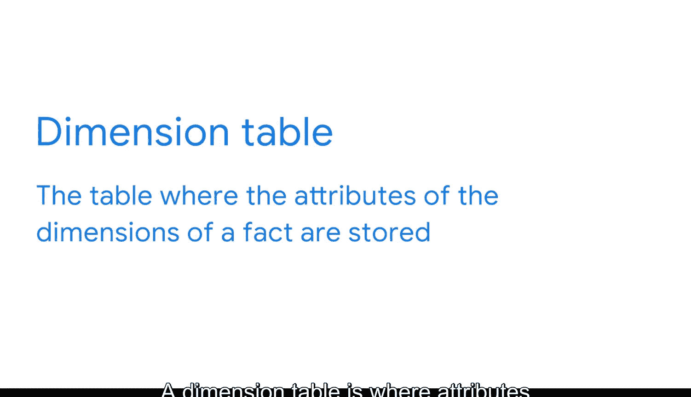

# 谷歌《谷歌商业智能（BI基础、洞察路线：模型和pipelines、决策：数据看板）｜Google Business Intelligence》 p44 05_01_02_用维度模型获取事实.zh_en -BV1yJ4m1V7W9_p44-

If you've been working with databases using SQL， you're probably already familiar with relational databases。

In this video， you're going to return to the concept of relational databases and learn about a specific kind of relational modelling technique that is used in business intelligence。

 Dial modelling as a refresher， a relational database contains a series of tables that could be connected to form relationships。

😊，These relationships are established using primary and foreign keys。

Check out this car dealership database。Branch I D is the primary key in the car dealerships table。

 but it is the foreign key in the product details table。 This connects these two tables directly。

Vin is the primary key in the product details table and the foreign key in the repair parts table。

 Notice how these connections actually create relationships between all of these tables。

Even the car dealerships and repair parts tables are connected by the product details table。

If you took the Google Data Analytic certificate， you learned that a primary key is an identifier in a database that references a column in which each value is unique。

For BI， we're going to expand this idea。A primary key is an identifier and a database that references a column or a group of columns in which each row uniquely identifies each record in the table。

In this database， we have primary keys in each table， branch ID， V and part ID。

A foreign key is a field within a database table that's a primary key in another table。

The primary keys from each table also appear as foreign keys in other tables。

 which builds those connections。Basically， a primary key can be used to impose constraints on the database that ensure data in a specific column is unique by specifically identifying a record in a relational database table。

Only one primary key can exist in a table， but a table may have many foreign keys。Okay。

 now let's move on to dimensional models。A dimensional model is a type of relational model that has been optimized to quickly retrieve data from a data warehouse。

Dimenssional models can be broken down into facts for measurement and dimensions that add attributes for context。

 in the dimensional model， a fact is a measurement or metric。For example。

 a monthly sales number could be a fact， and a dimension is a piece of information that provides more detail and context regarding that fact。

It's the who， what， where， when， why， and how。So if our monthly sales number is the fact。

 then the dimensions could be information about each sale， including the customer。

 the store location， and what products were sold。Next， let's consider attributes。

If you earned your Google data Analytic certificate， you learn about attributes and tables。

An attribute is a characteristic or a quality of data used to label the table columns。

In dimensional models， attributes work kind of the same way。

 An attribute is a characteristic or quality used to describe a dimension。

So a dimension provides information about a fact， and an attribute provides information about a dimension。

Think about a passport。One dimension on your passport is your hair and eye color。

If you have brown hair and eyes， Brown is the attribute that describes that dimension。

Let's use another simple example to clarify things。In our car dealership example。

 if we explore the customer dimension， we might have attributes such as name。

 address and phone number listed for each customer。Now that we've established the facts， dimensions。

 and attributes， it's time for the dimensional model to use these things to create two types of tables。

Fact tables and dimension tables。A fact table contains measurements or metrics related to a particular event。

This is the primary table that contains the facts and their relationship with the dimensions。

Basically， each throw in the fact table represents one event。

The entire table could aggregate several events， such as sales in a day。

A dimension table is where attributes of the dimensions of a fact are stored。

These tables are joined to the appropriate fact table using the foreign key。

This gives meaning and context to the facts。 And that's how tables are connected in a dimensional model。

 Understanding how dimensional modeling builds connections will help you understand database design as a B I professional。

This will also clarify database schemas， which are the output of design patterns coming up。

 we're going to check out different kinds of schemas that result from this type of modeling to understand how these concepts work in practice。

