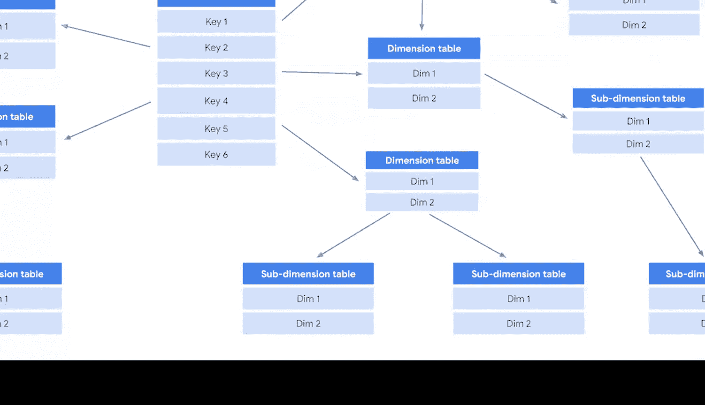

# 谷歌《谷歌商业智能（BI基础、洞察路线：模型和pipelines、决策：数据看板）｜Google Business Intelligence》 p45 06_01_03_星型与雪花型架构的维度模型.zh_en -BV1yJ4m1V7W9_p45-

In a previous video， we explored how B I professionals use dimensional models。

 They make it possible to organize data using connected facts。

 dimensions and attributes to create a design pattern。 A schema is the final output of that pattern。

 As you've learned， a schema is a way of describing how something such as data is organized。😊。

In a database， it's the logical definition of the data elements。

 physical characteristics and interrelationships that exist within the model。

Think of the schema like a blueprint。 It doesn't hold data itself。

 but describes the shape of the data and how it might relate to other tables or models。

Any entry in the database is an instance of that schema and will contain all of the properties described in the schema。

There are several common schemas that you may encounter in business intelligence， including star。

 snowflake and denormalize， or no sequel schemas。Star and snow like schemas are some of the most common iterations of an actual dimensional model in practice。

 A star schema is a schema consisting of one fact table that references any number of dimension tables。

As its name suggests， this schema is shaped like a star。

Notice how each of the dimension tables is connected to the fact table at the center。

Stars schemaas are designed to monitor data， instead of analyzing it。In this way。

 they enable analysts to rapidly process data。Therefore。

 they are ideal for high scale information delivery。

 and they make output more efficient because of the limited number of tables and clear direct relationships。

 Next， we have snowflake schemas， which tend to be more complicated than star schemas。

 But the principle is the same。 A snowflake schema is an extension of a star schema with additional dimensions and often sub dimensions。

These dimensions and sub dimensionmens break down the schema into even more specific tables。

 creating a snowflake pattern。Like snowflakes in nature。

 a snowflake schema and the relationships within it can be complex。Here's an example。

Notice how the fact table is still at the center。 But now there are sub dimension tables connected to the dimension tables。

 which gives us a more complicated web。 Now， you have a basic idea of the common schemas you might encounter in B I。

 Understanding schemas can help you recognize the different ways databases are constructed and how B I professionals influence database functionality。

 Later on， you're going to have more opportunities to explore these different schemas and even construct on yourself。

😊。

