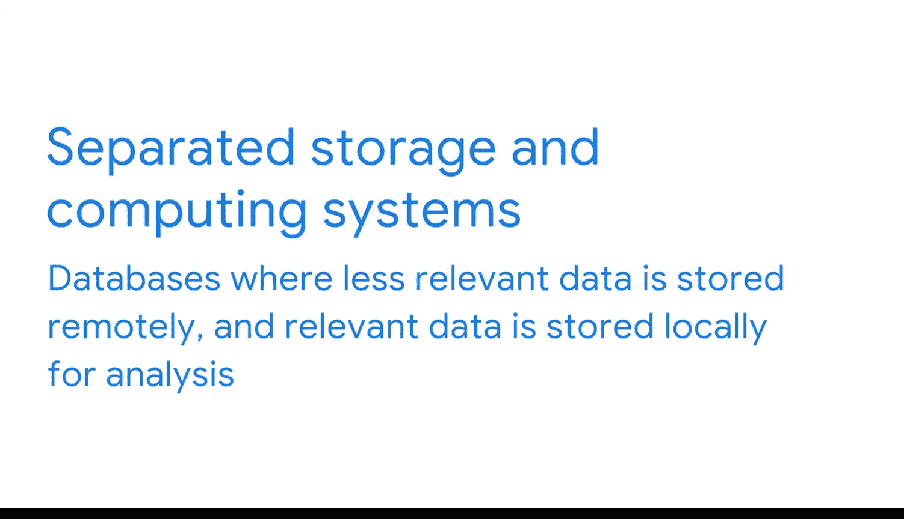

# 谷歌《谷歌商业智能（BI基础、洞察路线：模型和pipelines、决策：数据看板）｜Google Business Intelligence》 p46 07_01_05_不同数据类型对应不同数据库.zh_en -BV1yJ4m1V7W9_p46-

As we continue our discussion of database modeling and schemas。

 it's important to understand that there are different facets of databases that a business intelligence professional might need to consider for their organization。

This is because the database framework， including how platforms are organized and how data is stored and processed。

 affects how data is used。Let's start with an example。

 think about a grocery store's database systems， they manage daily business processes and analyze and draw insights from data。

For example， in addition to enabling users to manage sales。

 a grer's database must help decision makers understand what items customers are buying and which promotions are the most effective。

In this video， we're going to check out a few examples of database frameworks and learn how they're different from one another。

In particular， databases vary based on how the data is processed， organized and stored。

 For this reason， it's important to know what type of database your company is using。

You will design different data models depending on how data is stored and accessed on that platform。

In addition， another key responsibility for BI professionals is to facilitate database migrations。

 which are often necessary when technology changes and businesses grow。

 A database migration involves moving data from one source platform to another target database。

During a migration， users transition the current database schemas to a new desired state。

This could involve adding tables or columns， splitting fields， removing elements。

 changing data types or other improvements。The database migration process often requires numerous phases and iterations。

 as well as lots of testing。These are huge projects for BI teams。

 and you don't necessarily just want to take the original schema and use it in the new one。

So in this video， we'll discuss several types of databases， including OLTP， OL AP。

 row based columnar， distributed， single homed， separated storage and compute。

 and combined databases。The first two database technologies we're going to explore。

 OLTP and OL AP systems are based on how data is processed。As you've learned。

 an online transaction processing or OLTP database is one that has been optimized for data processing instead of analysis。

OLTP databases manage database modification and are operated with traditional database management system software。

These systems are designed to effectively store transactions and help ensure consistency。

 An example of an OLTP database would be an online bookstore。

If two people add the same book to their cart， but there's only one copy。

 then the person who completes the check out process first will get the book。

 and the O LTP system ensures that there aren't more copies sold than are in stock。

 O LT P databases are optimized to read， write and update single rows of data to ensure that business processes go smoothly。

 but they aren't necessarily designed to read many rows together。Next， as mentioned previously。

 OL A stands for online analytical Pro。This is a tool that has been optimized for analysis in addition to processing and can analyze data from multiple databases。

OLAP systems pull data from multiple sources at one time to analyze data and provide key business insights。

Going back to our online bookstore， an OLAP system could pull data about customer purchases from multiple data warehouses in order to create personalized homep pages for customers based on their preferences。

OLAP database systems enable organizations to address their analytical needs from a variety of data sources。

Depending on the data maturity of the organization。

 one of your first tasks as a BI professional could be to set up an O A P system。

Many companies have OLTP systems in place to run the business。

 but they'll rely on you to create a system that can prioritize analyzing data。

This is a key first step to drawing insights。Now， moving along to row based and column our databases。

As the name suggests， row based databases are organized by rows。

Each row in a table is an instance or an entry in the database。

 and details about that instance are recorded and organized by column。

This means that if you wanted the average profit of all sales over the last five years from the bookstore database。

 you would have to pull each row from those years。 even if you don't need all of the information contained in those rows。

Columnar databases， on the other hand， are databases organized by columns。

They are used in data warehouses because they are very useful for analytical queries。

Callum our databases process data quickly， only retrieving information from specific columns。

In our average profit of all sales example， with a column in our database。

 you could choose to specifically pull the sales column instead of years worth of rows。

The next databases are focus on storage。Single home databases are databases where all the data is stored in the same physical location。

This is less common for organizations dealing with large data sets and will continue to become rarer as more and more organizations move their data storage to online and cloud providers。

 Now， distributed databases are collection of data systems distributed across multiple physical locations。

Think about them like telephone books。 It's not actually possible to keep all the telephone numbers in the world in one book。

 It would be enormous。 So instead， the phone numbers are broken up by location and across multiple books in order to make them more manageable。

Finally， we have more ways of storing and processing data。

Combined systems are database systems that store and analyze data in the same place。

This is a more traditional setup because it enables users to access all the data that needs to stay in the system long term。

 but can become unwieldy as more data is added。 like the name implies。

 separated storage and computing systems are databases where less relevant data is stored remotely and the relevant data is stored locally for analysis。

😊。

This helps the system run analytical queries more efficiently because you interact with relevant data。

 It also makes it possible to scale storage and computations independently。For example。

 if you have a lot of data， but only a few people are querying it。

 you don't need as much computing power which can save resources。

There are a lot of aspects of databases that could affect a BI professional's work。

Understanding if a system is OLTP or OL A， relational or columnar， distributed or single homed。

 separated storage and computing or combined， or even some combination of these is essential。

Coming up， we'll go even more in depth about organizing data。

