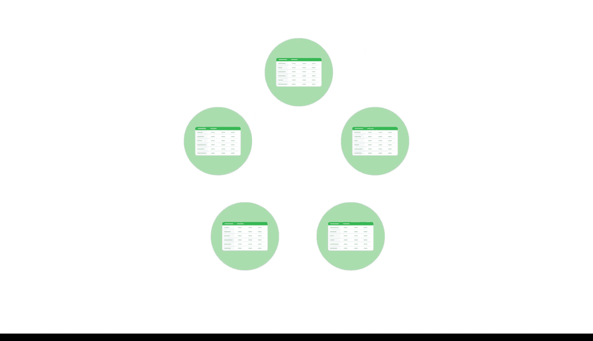

# 谷歌《谷歌商业智能（BI基础、洞察路线：模型和pipelines、决策：数据看板）｜Google Business Intelligence》 p47 08_01_01_数据的形态.zh_en -BV1yJ4m1V7W9_p47-

You've been investigating data modeling and database schemas。

 as well as how different types of databases are used in BI。

Now we're going to explore how these concepts can be used to design data warehouses。

 but before we get into data warehouse design， let's get a refresher on what a data warehouse actually is。

As you probably remember from earlier in this course。

 a database is a collection of data stored in a computer system。 Well。

 a data warehouse is a specific type of database that consolidates data from multiple source systems for data consistency。

 accuracy and efficient access。Data warehouses are used to support data driven decision making。

 Often， these systems are managed by data warehousing specialists。

 but B I professionals may help design them when it comes to designing a data warehouse。

 There are a few important things a B I professional will consider。Business needs。

 the shape and volume of the data， and what model the data warehouse will follow。

Business needs are the questions the organization wants to answer or the problems they want to solve。

These needs help determine how it will use， store， and organize its data。For example。

 a hospital storing patient records to monitor health changes has different data requirements than a financial firm analyzing market trends to determine investment strategies。

Next， let's explore the shape and volume of data from the source system。Typically。

 the shape of data refers to the rows and columns of tables within the warehouse and how they are laid out。

The volume of data currently and in the future also changes how the warehouse is designed。

And the model the warehouse will follow includes all of the tools and constraints of the system。

Such as the database itself and any analysis tools that will be incorporated into the system。

Let's return to our bookstore example。To develop its data warehouse。

 we first need to work with stakeholders to determine their business needs。

You'll have an opportunity to learn more about gathering information from stakeholders later。

 But for now， let's say they tell us that they're interested in measuring store profitability and website traffic in order to evaluate the effectiveness of annual promotions。

😊，Now we can look at the shape of the data。 consider the business processes or events that are being captured by tables in the system。

Because this is a retail store， the primary business process is sales。

We could have a sales table that includes information such as quantity ordered， total base amount。

 total tax amount， total discounts and total net amount。These are the facts as a refresher。

 a fact is a measurement or metric used in the business process。

These facts could be related to a series of dimension tables that provide more context。For instance。

 store customer。Product， promotion， time， stock or currency could all be dimensions。

The information in these tables gives more context to our fact tables。

 which record the business processes and events。Notice how this data model is starting to shape up。

There are several dimension tables all connected to a fact table at the center。

And this means we just created a star schema。With this model， you can answer the specific question。

 the effectiveness of annual promotions and also generate a dashboard with other K Ps and drill down reports。

 In this case， we started with the business' specific needs。

 looked at the data dimensions we had and organized them into tables that formed relationships。😊。

Those relationships helped us determine that a star schema would be the most useful way to organize this data warehouse。

 Understanding the logic behind data warehouse design will help you develop effective BI processes and systems。

Coming up， you're going to work more with database schemas and learn about how data is pulled into the warehouse from other sources。

