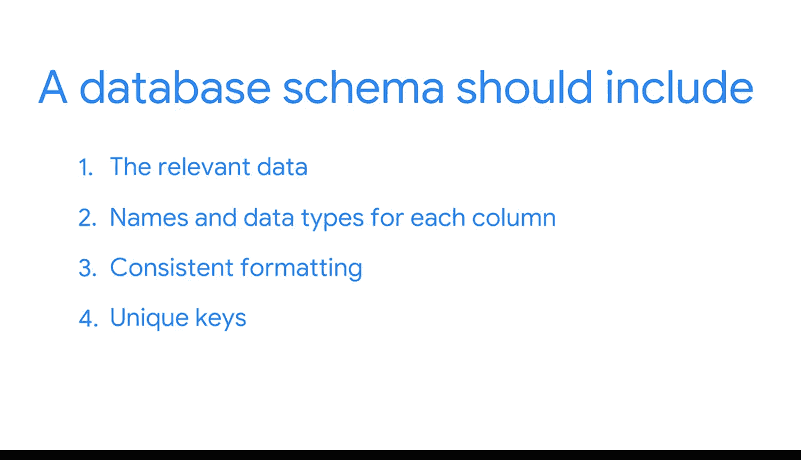

# 谷歌《谷歌商业智能（BI基础、洞察路线：模型和pipelines、决策：数据看板）｜Google Business Intelligence》 p48 09_01_02_设计实用的数据库架构.zh_en -BV1yJ4m1V7W9_p48-

Earlier， we learned about what considerations go into designing data warehouses based on the business needs and the shape of the data in our previous example。

 we created a dimensional model with a star schema。

That process is sometimes called logical data modeling。

 This involves representing different tables in the physical data model。

Decisions have to be made about how a system will implement that model。 In this video。

 we're going to learn more about what a schema needs to have for it to be functional。Later。

 you will use your database schema to validate incoming data to prevent system errors and ensure that the data is useful。

For all of these reasons， it's important to consider the schema early on in any BI project。

There are four elements a database schema should include。The relevant data。

 names and data types for each column in each table。Consistent formatting across data entries。

And unique keys for every database， entry and object。As we have already learned。

 a database schema is a way of describing how data is organized。

It doesn't actually contain the data itself， but describes how the data is shaped and the relationships within the database。

It needs to include all the data being described， or else it won't be a very useful guide for users trying to understand how the data is laid out。

Let's return to our bookstore database example， we know that our data contains a lot of information about the promotions。

 customers， products， dates， and sales。If our schema doesn't represent that。

 then we're missing key information。For instance， it's often necessary for a B I professional to add new information to an existing schema if the current schema can't answer a specific business question。

So if the business wants to know which customer service employee responded the most to requests。

We would need to add that information to the data warehouse and update this schema accordingly。

The schema also needs to include names and data types for each column in each table within the database。

 Imagine if you didn't organize your kitchen drawers。

 It would be really difficult to find anything if all of your utensils were just thrown together。

Instead， you probably have a specific place where you keep your spoons， forks and knives。

Columns are like your kitchen drawer organizers。They enable you to know what items go where in order to keep things functional。

So your schema needs to include the column names and the data type to indicate what data belongs there。

In addition to making sure the schema includes all of the relevant data。

 names and data types for each column， it's also important to have consistent formatting across all of the data entries in the database。

Every data entry is an instance of the schema。For example。

 imagine we have two transactional systems that we are combining into one database。

One tracks the promotions sent to users， and the other tracks sales to customers。

In the source systems， the marketing system that tracks promotions could have a user ID column。

While the sale system has customer I D instead。To be consistent in our warehouse schema。

 well want to use just one of these columns。In the schema for this database。

 we might have a column in one of our tables for product prices。

If this data is stored as string type data， instead of numerical data。

 it can't be used in calculations such as adding sales together in a query。Additionally。

 if any of the data entries have columns that are empty or missing values， this might cause issues。

Finally， it's important that there are unique keys for each entry within the database。

We covered primary and foreign keys in previous videos。

These are what build connections between tables and enable us to combine relevant data from across the entire database。

So in summary， in order for a database schema to be useful。

 it should contain the relevant data from the database。

 the names and data types for each column in each table。

Consistent formatting across all of the entries within the database and unique keys connecting the tables。

These four elements will ensure that your schema continues to be useful。

Developing your schema is an ongoing process。As your data or business needs change。

 you can continue to adapt the database schema to address these needs。More to come on that soon。

