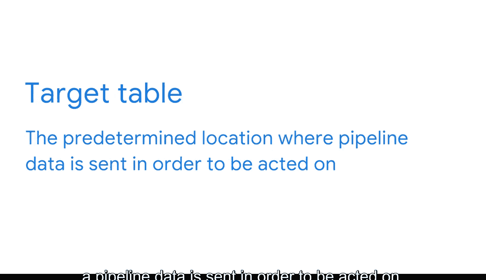

# 谷歌《谷歌商业智能（BI基础、洞察路线：模型和pipelines、决策：数据看板）｜Google Business Intelligence》 p49 10_01_01_数据管道与ETL流程.zh_en -BV1yJ4m1V7W9_p49-

So far， we've been learning a lot about how data is organized and stored within data warehouses and how schemas describe those systems。

Part of your job as a BI professional is to build and maintain a data warehouse。

 taking into consideration all of these systems that exist and are collecting and creating data points。

To help smooth this process， we use data pipelines as a refresher。

 a data pipeline is a series of processes that transports data from different sources to their final destination for storage and analysis。

This automates the flow of data from sources to targets。

 while transforming the data to make it useful as soon as it reaches its destination。In other words。

 data pipelines are used to get data from point A to point B， automatically， save time and resources。

 and make data more accessible and useful。Basically， data pipelines define what。

 where and how data is combined。They automate the processes involved in extracting， transforming。

 combining， validating and loading data for further analysis and visualization。

Effective data pipelines also help eliminate errors and combat system latency。

Having to manually move data over and over whenever someone asks for it or to update a report repeatedly would be very time consuming。

For example， if a weather station is getting daily information about weather conditions。

 it would be difficult to manage it manually because of the sheer volume。

They need a system that takes in the data and gets it where it needs to go so it can be transformed into insights。

One of the most useful things about a data pipeline is that it can pull data from multiple sources consolidated。

 and then migrated over to its proper destination。These sources could include relational databases。

 a website application with transactional data or an external data source。Usually。

 the pipeline has a push mechanism that enables it to ingest data from multiple sources in near real time or at regular intervals。

Once the data has been pulled into the pipeline， it can be loaded to its destination。

This could be a data warehouse， data lake or data Mart， which we'll learn more about coming up。

Or could be pulled directly into a BI or analytics application for immediate analysis。Often。

 while data is being moved from point A to point B， the pipeline is also transforming the data。

Transformations include sorting， validation and verification， making the data easier to analyze。

This process is called an ETL system。ETL stands for extracttract， transformform， and load。

This is the type of data pipeline that enables data to be gathered from source systems。

 converted into a useful format and brought into a data warehouse or other unified destination system。

ETL is becoming more and more standard for data pipelines。

 so we're going to learn more about it later on。Let's say a business analyst has data in one place and needs to move it to another。

That's where a data pipeline comes in。But a lot of the time。

 the structure of the source system isn't ideal for analysis。

 which is why a B I professional wants to transform that data before it gets to the destination system。

 And why having set database schemas already designed and ready to receive data is so important。

Let's now explore these steps in a little more detail。

 When you can think of a data pipeline functioning in three stages。Ingesting the rawdita。

Processing and consolidating it into categories and dumping the data into reporting tables that users can access。

These reporting tables are referred to as target tables。

Target tables are the predetermined locations where pipeline data is sent in order to be acted on。

Processing and transforming data while it is being moved is important because it ensures the data is ready to be used when it arrives。

But let's explore this process in action。Say we're working with an online streaming service to create a data pipeline。

First， we'll want to consider the end goal of our pipeline。In this example。

 our stakeholders want to understand their viewer demographics to inform marketing campaigns。

This includes information about their viewers' ages and interests， as well as where they are located。

Once we've determined what the stakeholder's goal is。

 we can start thinking about what data we need the pipeline to ingest。In this case。

 we're going to want demographic data about the customers。

Our stakeholders are interested in monthly reports。

So we can set up our pipeline to automatically pull in the data we want monthly intervals。

Once the data is ingested， we also want our pipeline to perform some transformations so that it is clean and consistent once it gets delivered to our target tables。

Note that these tables would have already been set up within our database to receive the data。

And now we have our customer demographic data and their monthly streaming habits in one table ready for us to work with。

The great thing about data pipelines is that once they're built。

 they can be scheduled to automatically perform tasks on a regular basis。

This means B I team members can focus on drawing business insights from the data rather than having to repeat this process over and over again。

As a B I professional， a big part of your job will involve creating these systems。

 ensuring that they're running correctly and updating them whenever business needs change。

It's a valuable benefit that your team will really appreciate。

