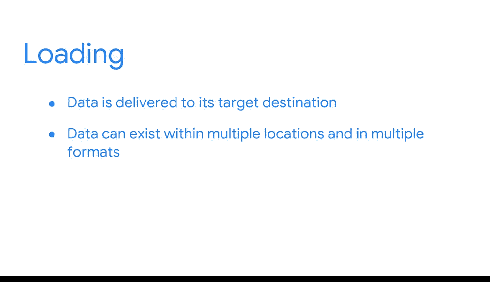

# 谷歌《谷歌商业智能（BI基础、洞察路线：模型和pipelines、决策：数据看板）｜Google Business Intelligence》 p50 11_01_02_通过ETL流程最大化数据价值.zh_en -BV1yJ4m1V7W9_p50-

We've been learning a lot about data pipelines and how they work。

Now we're going to discuss a specific kind of pipeline ETL。

 I mentioned previously that ETL enables data to be gathered from source systems。

 converted into a useful format and brought into a data warehouse or other unified destination system。

Like other pipelines， ETO processes work in stages， and these stages are extract， transform。

 and load。Let's start with extraction。In this stage。

 the pipeline accesses source systems and then reads and collects the necessary data from within them。

 Many organizations store their data in transactional databases such as OLTP systems。

 which are great for logging records。Or maybe the business uses flat files。 For instance。

 H T M L or log files。Either way， ETO makes the data useful for analysis by extracting it from its source and moving it into a temporary staging table。

 Next， we have transformation。The specific transformation activities depend on the structure and format of the destination and the requirement of the business case。

 But as you've learned， these transformations generally include validating。

 cleaning and preparing the data for analysis。This stage is also when the ETL pipeline maps the data types from the sources to the target systems。

 so that the data fits the destination conventions。Finally， we have the loading stage。

This is when data is delivered to its target destination。That could be a data warehouse。

 a data lake or an analytics platform that works with direct data feeds。

Note that once the data has been delivered， it can exist within multiple locations in multiple formats。

For example， there could be a snapshot table that covers a week of data and a larger archive that has some of the same records。

This helps ensure that historical data is maintained within the system while giving stakeholders focused timely data。

 and if the business is interested in understanding and comparing average monthly sales。

 the data would be moved to an OL A system that has been optimized for analysis queries。

ETL processes are a common type of data pipeline that BI professionals often build and interact with。

Coming up， you're going to learn more about these systems and how they're created。

