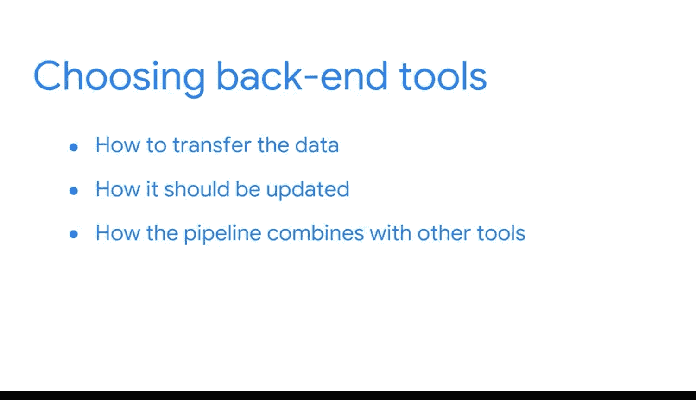

# 谷歌《谷歌商业智能（BI基础、洞察路线：模型和pipelines、决策：数据看板）｜Google Business Intelligence》 p51 12_01_03_为任务选择合适的工具.zh_en -BV1yJ4m1V7W9_p51-

In previous videos， we've been exploring pipeline processes that ingest data from different sources。

 transform it to match the destination formatting， and push it to a final destination where users can start drawing business insights。

BI professionals play a key role in building and maintaining these processes。

 and they use a variety of tools to help them get the job done。In this video。

 we'll learn how BI professionals choose the right tool。As a BI professional。

 your organization will likely have preferred vendors。

 which means you'll be given a set of available BI solutions。

One of the great things about B I is that different tools have very similar principles behind them and similar utility。

This is another example of a transferable skill。In other words。

 your general understanding can be applied to other solutions。

 no matter which ones your organization prefers。For instance。

 the first database management system I learned was Microsoft Access。

This experience helped me gain a basic understanding of how to build connections between tables。

And that made learning new tools more straightforward later in my career。

When I started working with my SQL， I was already able to recognize the underlying principles。Now。

 it's possible that you'll choose the tools you'll be using。 if that's the case。

 you'll want to consider the Kpis， how your stakeholders want to view the data and how the data needs to be moved。

As you've learned， a KPI is a quantifiable value closely linked to the business strategy。

 which is used to track progress toward a goal。KPIs let us know whether or not we're succeeding so that we can adjust our processes to better reach objectives。

For example， some financial Kpis are gross profit margin， net profit margin and return on assets。

Or some HR Kpis are rate of promotion and employee satisfaction。

Understanding your organization's KPIs means you can select tools based on those needs。Next。

 depending on how your stakeholders want to view the data， there are different tools you can choose。

Stakeholders might ask for graphs， static reports or dashboards。There are a variety of tools。

 including Looker Studio， Microsoft Power B I and Tableau。 some others are Azure analysis service。

 Cloud SQL， Pentaho， SSA S and SS R S SQL Ser， which all have reporting tools built in。

That's a lot of options。 You'll get more insights about these different tools later on。

After you've thought about how your stakeholders want to view the data。

 you'll want to consider your backend tools。This is when you think about how the data needs to be moved。

For example， not all BI tools can read data lakes。 So if your organization uses data lakes to store data。

 then you need to make sure you choose a tool that can do that。

 Some other important considerations when choosing your back end tools include how to transfer the data。

How it should be updated and how the pipeline combines with other tools in the data transformation process。

Each of these points helps you determine must halves for your tool set。

 which leads to the best options。Also， it's important to know that you might end up using a combination of tools to create the ideal system。

As you've been learning， BI tools have common features。

 so the skills you learn in these courses can be used no matter which tools you end up working with。

Going back to my example， I was able to understand the logic behind transforming and combining tables。

 whether I was using Microsoft Access or Mysql。This foundation has transferred across the different B I tools I have encountered throughout my career。

Coming up， you'll learn more about the solutions that you might work with in the future。

You'll also start getting hands on with some data soon。

