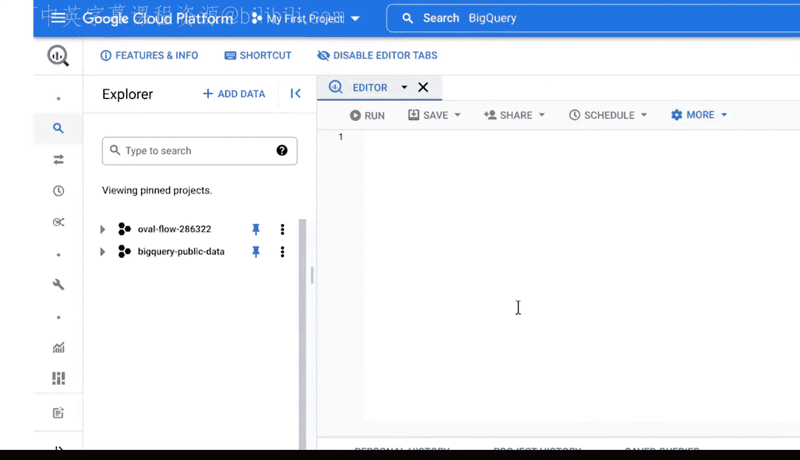

# 谷歌《谷歌商业智能（BI基础、洞察路线：模型和pipelines、决策：数据看板）｜Google Business Intelligence》 p52 13_01_01_Dataflow简介.zh_en -BV1yJ4m1V7W9_p52-

Recently， you were introduced to data pipelines。You learn that many of the procedures and understandings involved in one pipeline tool can be transferred to other solutions。

 So in this course， we're going to be using Google dataflow。

But even if you end up working with a different pipeline tool。

 the skills and steps involved here will be very useful。

And using Google Dataflowlow now will be a great opportunity to practice everything you've learned so far。

We'll start by introducing you to Dataflowlow and going over its basic utilities。Later on。

 you'll use this tool to complete some basic BI tasks and set up your own pipeline。

Google Dataflowlow is a serverless data processing service that reads data from the source。

 transforms it， and writes it in the destination location。

Dataflowlow creates pipelines with open source libraries which you can interact with using different languages including Python and SQL。

Dataflowlow includes a selection of prebuilt templates that you can customize。

Or you can use SQL statements to build your own pipelines。

The tool also includes security features to help keep your data safe。Okay。

 let's open Dataflow and export it together now。First， we'll log in and go to the console。

Once the console is open， let's find the jobs page。If this is your first time using Dataflowlow。

 it will say no jobs to display。The Jo page is where we'll find current jobs in our project space。

There are options to create job from template or create job from SQL。

Snapshots save the current state of a streaming pipeline so that you can start a new version without losing the current one。

This is great for testing your pipelines， updating them seamlessly for users。

 and backing up and recovering old versions。The Pi section contains a list of the pipelines you have created。

Again， if this is your first time using Dataflowlow。

 it will display the processes you need to enable before you can start building pipelines。

Now is a great time to do that just click fixix All to enable the API features and set your location。

The notebook section enables you to create and save shareable Jupiter notebooks with live code。

This is useful for first time ETL tool users to check out examples and visualize the transformations。

Finally， we have the SQL workspace。If you have worked with BigQuery before。

 such as in the Google Data Analytic certificateer， this will be familiar。

This is where you write and execute SQL queries while working within dataflow。 And there you go。

 Now you can log into Google Dataflow and start exploring it on your own。

We'll have many more opportunities to work with this tool soon。

