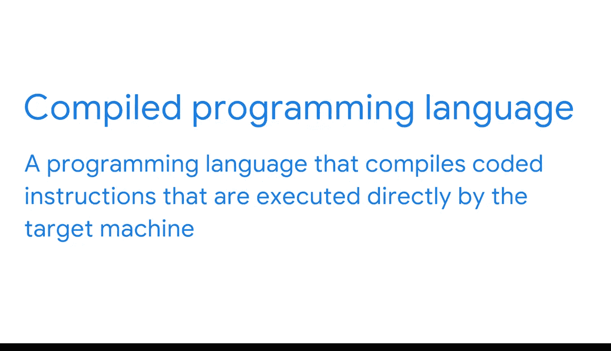

# 谷歌《谷歌商业智能（BI基础、洞察路线：模型和pipelines、决策：数据看板）｜Google Business Intelligence》 p53 14_01_03_Python编程实践.zh_en -BV1yJ4m1V7W9_p53-

If you're coming to these courses from the Google Data Analytics certificateer。

 or if you've been working with relational databases。

 you're probably familiar with the query language SQL。

Query languages are specific computer programming languages used to communicate with a database。

As a B I professional， you may be expected to use other kinds of programming languages， too。

 That's why in this video， we'll explore one of the most popular programming languages out there。

 Python， a programming language is a system of words and symbols used to write instructions that computers follow。

😊，There are lots of different programming languages。

 but Python was specifically developed to enable users to write commands in fewer lines than most other languages。

 Python is also open source， which means it's freely available and may be modified and shared by the people who use it。

There's a large community of Python users who develop tools and libraries to make Python better。

 which means there are a lot of resources available for BI professionals to tap into。

Python is a general purpose programming language that can be applied to a variety of contexts。

In business intelligence， it's used to connect to a database system to read and modify files。

It can also be combined with other software tools to develop pipelines。

And it can even process big data and perform calculations。

There are a few key things you should understand about Python as you begin your programming journey。

First， it is primarily object oriented and interpreted。

Let's first understand what it means to be object oriented。

Object oriented programming languages are modeled around data objects。

These objects are chunks of code that capture certain information。Basically。

 everything in the system is an object。And once data has been captured within the code。

 it's labeled and defined by the system so that it can be used again later without having to reenter the data。

Because Python has been adopted pretty broadly by the data community。

 a lot of libraries have been developed to predeefine data structures and common operations that you can apply to the objects in your system。

This is extremely useful when you need to repeat analysis or even use the same transformations for multiple projects。

Not having to reenter the code from scratch saves time。

 Note that object oriented programming languages differ from functional programming languages which are modeled around functions。

While Python is primarily object oriented， it can also be used as a functional programming language to create and apply functions。

Part of the reason Python is so popular is that it's flexible。But for B I。

 the really valuable thing about Python is its ability to create and save data objects that can then be interacted with via code。

 Okay， now let's consider the fact that Python is an interpreted language。😊。

Interpreted languages are programming languages that use an interpreter。

 Tyically another program to read and execute coded instructions。

This is different from a compiled programming language。

 which compiles coded instructions that are executed directly by the target machine。

One of the biggest differences between these two types of programming languages is that the compiled code executed by the machine is almost impossible for humans to read。

 So Python's interpreted language is very useful for B I professionals because it enables them to use the language in an interactive way。

For example， Python can be used to make notebooks。 A notebook is an interactive。

 editable programming environment for creating data reports。

This can be a great way to build dynamic reports for stakeholders。

 Python is a great tool to have in your B I toolbox。

 There's even an option to use Python commands and Google data flow。😊，Pretty soon。

 you'll get to check it out for yourself when you start writing Python in your dataflow workspace。

