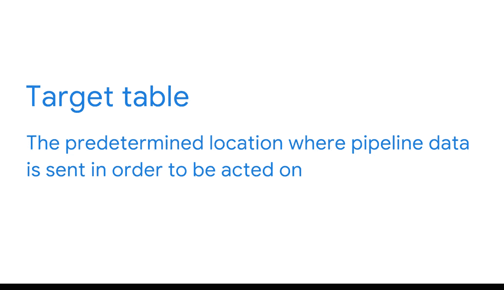

# 谷歌《谷歌商业智能（BI基础、洞察路线：模型和pipelines、决策：数据看板）｜Google Business Intelligence》 p54 15_01_01_从利益相关方收集信息.zh_en -BV1yJ4m1V7W9_p54-

You've already learned quite a bit about the different stakeholders that a B I professional might work with in an organization and how to communicate with them。

You've also learned that gathering information from stakeholders at the beginning of a project is an essential step of the process。

Now that you understand more about pipelines， let's consider what information you need to gather from stakeholders before building BI processes for them。

That way， you'll know exactly what they need and can help make their work as efficient as possible。

Part of your job as a BI professional is understanding the current processes in place and how you can integrate BI tools into those existing work streams。

Oftentimes， in B， you aren't just trying to answer individual questions every day。

You're trying to find out what kinds of questions your team is asking so that you can build them a tool that enables them to get that information themselves。

It's rare for people to know exactly what they need and communicate that to you。Instead。

 they will usually come to you with a list of problems or symptoms。

 And it's your responsibility to figure out how to help them。

Stakeholders who are less familiar with data simply don't know what BI processes are possible。

This is why cross business alignment is so important。

You want to create a user centered design where all of the requirements for the entire team are met。

That way， your solutions address everyone's needs at once， streamlining their processes as a group。

It can be challenging to figure out what all of your different stakeholders require。

One option is to create a presentation and lead a workshop session with the different teams。

This can be a great way to support cross business alignment and determine everyone's needs。

 It's also very helpful to spend some time observing your stakeholders at work and asking them questions about what they're doing and why。

😊，In addition， it's important to establish the metrics and what data the target table should contain early on with cross team stakeholders。

This should be done before you start building the tools。As you've learned。

 a metric is a single quantifiable data point that is used to evaluate performance。In B I。

 the metrics businesses are usually interested in are Kpis that help them assess how successful they are at achieving certain goals。

Understanding those goals and how they can be measured is an important first step in building a B I tool。

 You also know that target tables are the final destination where data is acted on。

So understanding the end goals helps you design the best process。

It's important to remember that building BI processes is a collaborative and iterative process。

You will continue gathering information from your stakeholders and using what you've learned until you create a system that works for your team。

And even then， you might change it as new needs arise。Often。

 your stakeholders will have identified their questions。

 but they may not have identified their assumptions or biases about the project yet。

This is where a BI professional can offer insights。

Collaborating closely with stakeholders ensures that you are keeping their needs in mind as you design the BI tools that will streamline their processes。

Understanding their goals， metrics and final target tables and communicating across multiple teams will ensure that you make systems that work for everyone。

