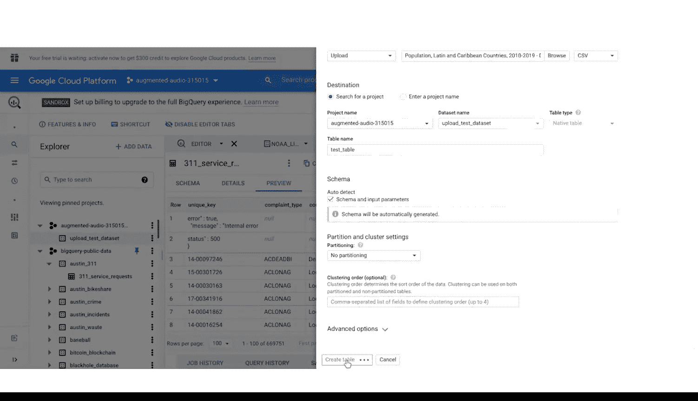

# 谷歌《谷歌商业智能（BI基础、洞察路线：模型和pipelines、决策：数据看板）｜Google Business Intelligence》 p58 19_01_03_可选复习：谷歌数据分析证书-BigQuery相关内容.zh_en -BV1yJ4m1V7W9_p58-

Hey there。 In this video， we're going to learn about each part of the BigQuery SQL workspace so you can use it during this course and throughout your career as a data analyst。

 it's an extremely valuable and widely popular tool。 So understanding how it works is super helpful。

😊，Feel free to follow along on your screen as we explore BigQuery。

You may notice that my screen appears a little different than yours since BigQuery is constantly updating its interface。

 Don't worry if this happens as minor differences won't stop you from understanding the basics to begin。

 go to the Bigque landing page。 Then log into the account you created earlier。

To navigate to the SQL workspace， select the menu on the left side of the screen and scroll down to the big data header。

Then hover over the BigQu label and click SQL workspace from the dropdown。

Now that we're in the SQL workspace， we're going to search for public data sets。

 select a data through the data Explorer， run a query。

 and upload our own data for querying First we'll search for a public data to use。

To select a public data set， navigate to the Explorer menu on the left side of the screen。

Click the add data button in the upper right of the menu。Then in the drop down menu。

 select explore public data sets。 This will open the marketplace and show you available public data sets。

Let's go to the search Marketplace bar and search for NOAA underscore Lightning。

 A data set we'll use in an upcoming activity。😊，Click on the cloud to Gro Lightning Strikes dataset set。

This will give us a description and preview of the data。

 which captures observations about lightning activity and weather patterns in the United States。

Click View data set。 This will bring you back to the SQL workspace and create a tab for the data。

We can then move back to the editor tab we have open or click composeose New query to begin writing with SQL。

On the left， notice that the BigQuery public data drop down list is in the Exper menu。

 We can click the arrow to expand the BigQu data list and pick out a new data set。

Let's select the first data set in the drop down list。 Austin underscore 3，1，1。 When we do。

 it expands to show the table within the data set。 We can open the data set for a preview。

 The schema tab contains the names of each column in the data set。

 The details tab contains additional metadata， such as the creation data of the data set。

The preview tab contains the first rows from the data。On this page。

 we can click query to automatically create a new editor window with the template for a query already populated。

From here， put an asterisk after select where our cursor pops up， then run the query。Congratulations。

 you ran a SQL query in BigQu。 The query you ran returned rows from the data set。

 which populate in a window beneath the editor interface。

 resultssult from any query you run will also display here。😊，Now。

 let's say you have the results of a survey that you want to upload to BigQuery and analyze using SQL。

To add your own data to BigQuery， choose the ID of the project you want to add to。

Select the three vertical dots icon to open options for the project， then choose Create Data set。

Name the data something that will help you identify it later， such as upload test data set。

 then click Create data set。Next， go to the Exper menu and choose the three vertical dots next to the data set under the project's dropdown。

Now， we'll select the icon for create table， which opens a pop up window under source and create table from。

 select Up or whichever method you prefer to upload your data here。

 we can upload any data file such as a CSV file。Let's give our table a helpful name。

 such as Test_ Table。Make sure that the schema is set to auto detectect and select Create Table。

There's more to come with BigQuery。 Feel free to rewatch this video anytime and keep practicing。

 See you soon。😊。

