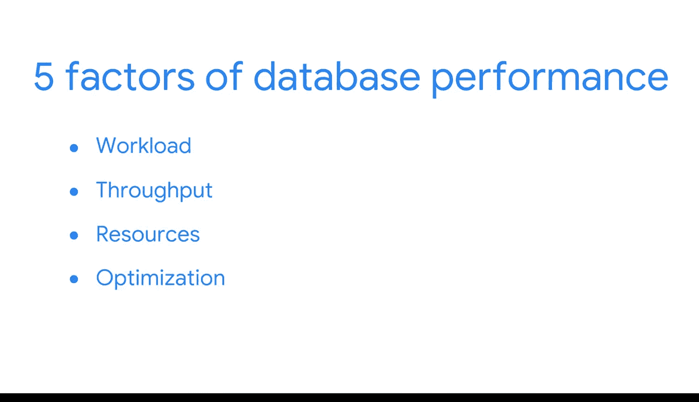

# 谷歌《谷歌商业智能（BI基础、洞察路线：模型和pipelines、决策：数据看板）｜Google Business Intelligence》 p59 20_02_01_欢迎来到模块2.zh_en -BV1yJ4m1V7W9_p59-

In order to efficiently deliver the most up to date information to your stakeholders。

 you must first understand and optimize career performance within your pipelines。

And that's where we're going to explore in the next few videos。

 We'll discover how to increase throughput and minimize the competition for resources within the system to enable the largest possible workload to be processed。

😊，We'll get into database systems including data mars， data lakes。

 data warehouses and ELT processes that's not a typo ELT is different from ETL。It stands for extract。

 load and transform。You'll also witness how these systems contribute to the overall efficiency of your data systems。

In addition， you'll investigate the five factors of database performance。Workload throughput。

Resources， optimization and contention。

And you'll gain some tips for making sure your database intake and storage are the best they can be。

Finally， we'll begin thinking about how to design efficient queries that really get the most out of your systems。

Let's do it。

