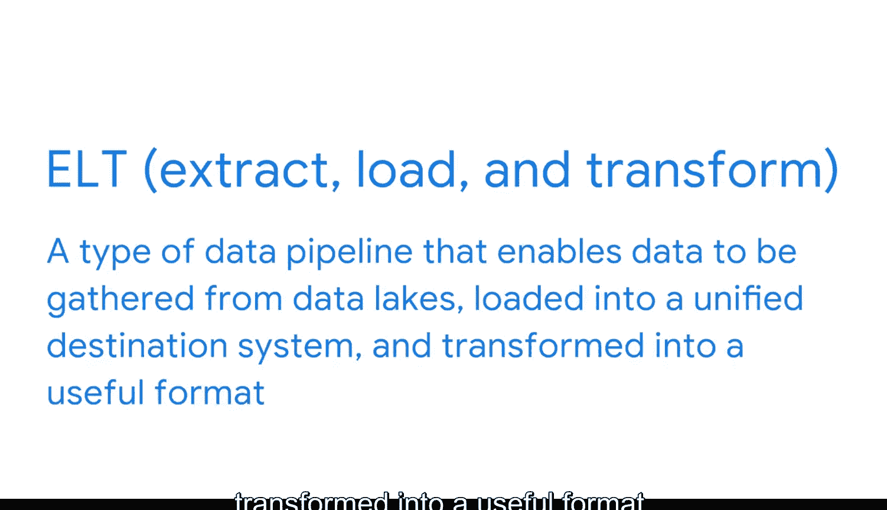

# 谷歌《谷歌商业智能（BI基础、洞察路线：模型和pipelines、决策：数据看板）｜Google Business Intelligence》 p60 21_02_02_数据集市、数据湖与ETL流程.zh_en -BV1yJ4m1V7W9_p60-

One of the amazing things about B is that the tools and processes are constantly evolving。

 which means BI professionals always have new opportunities to build and improve current systems。😊。

So let's learn about some other interesting data storage and processing patterns you might encounter as a BI professional。

Throughout these courses， we've learned about database systems that make use of data warehouses for their storage needs。

As a refresher， a data warehouse is a specific type of database that consolidates data from multiple source systems for data consistency。

 accuracy and efficient access。Basically， a data warehouse is a huge collection of data from all the company's systems。

Data warehouses were really common when companies used a single machine to store and compute their relational databases。

However， with the rise of cloud technologies and explosion of data volume。

 new patterns for data storage and computation emerged。One of these tools is a datamart。

As you may recall， a data mark is a subject oriented database that can be a subset of a larger data warehouse。

 N B I subject oriented， describes something that is associated with specific areas or departments of a business。

 such as finance， sales or marketing。As you're learning。

 B I projects commonly focus on answering various questions for different teams。

 So a data mark is a convenient way to access the relevant data that needs to be pulled for a particular project。

Now， let's check out data lakes。 A data lake is a database system that stores large amounts of raw data in its original format until it's needed。

This makes the data easily accessible because it doesn't require a lot of processing like a data warehouse。

 a data lake combines many different sources。But data warehouses are hierarchical。

 with files and folders to organize the data。

Whereas data lakes are flat。And while data has been tagged， so it is identifiable。

 It's not organized。 It's fluid， which is why it's called a data lake。

Data lakes don't require the data to be transformed before storage。

 so they are useful if your BI system is ingesting a lot of different data types。But of course。

 this data eventually needs to get organized and transformed。

One way to integrate data lakes into a data system is through ELT。Previously。

 we learned about the E T L process， where data is extracted from the source into the pipeline。

 transformed while it is being transported and then loaded into its destination。

ELT takes the same steps， but reorganizes them so that the pipeline extracts。

 loads and then transforms data。 Basically， ELT is a type of data pipeline that enables data to be gathered from different sources。

 usually data lakes then loaded into a unified destination system and transformed into a useful format。

ELT enables BI professionals to ingest so many different kinds of data into a storage system as soon as that data is available。

And they only have to transform the data they need。

ELT also reduces storage costs and enables businesses to scale storage and computation resources independently。

As technology advances， the processes and tools available also advance。 And that's great。

 Some of the most successful B I professionals do well because they are curious， lifelong learners。😊。

