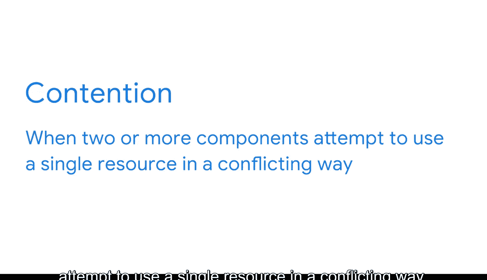

# 谷歌《谷歌商业智能（BI基础、洞察路线：模型和pipelines、决策：数据看板）｜Google Business Intelligence》 p61 22_02_04_数据库性能五要素.zh_en -BV1yJ4m1V7W9_p61-

We've been investigating database optimization and why it's important to make sure that users are able to get what they need from the system as efficiently as possible。

 Suessful optimization can be measured by the database performance。

 Dataase performance is a measure of the workload that can be processed by a database。

 as well as associated costs。In this video， we're going to consider the factors that influence database performance。

Workload， throughput， resources， optimization and contention。First。

 we'll start with workload N B workload refers to the combination of transactions，queries。

 analysis and system commands being processed by the database system at any given time。

It's common for a database's workload to fluctuate drastically from day to day。

 depending on what jobs are being processed and how many users are interacting with the database。

The good news is that you can often predict these fluctuations。 For instance。

 there might be a higher workload at the end of the month when reports are being processed or the workload might be really light right before a holiday。

😊，Next， we have throughput。Thput is the overall capability of the database's hardware and software to process requests。

 Throughput is made up of the input and output speed。 The central processor unit speed。

 How well the machine can run parallel processes， the database management system and the operating system and system software。

Basically， throughput describes as a workload size that the system can handle。 Okay。

 let's get into resources。InBI， resources are the hardware and software tools available for use in a database system。

This includes the disk base and memory。Resources are a big part of a database system's ability to process requests and handle data。

And they can also fluctuate， especially if the hardware or other dedicated resources are shared with additional databases。

 software applications or services。Also， cloud based systems are particularly prone to fluctuation。

So it's useful to remember that external factors can affect performance。Now we come to optimization。

Optimization involves maximizing the speed and efficiency with which data is retrieved in order to ensure high levels of database performance。

This is one of the most important factors that B I professionals return to again and again。

 So coming up soon， we're going to talk about it in more detail。Finally。

 the last factor of database performance is contention。

Contention occurs when two or more components attempt to use a single resource in a conflicting way。

This can really slow things down。 For instance， if there are multiple processes trying to update the same piece of data。

 those processes are in contention。As contention increases， the throughput of the database decreases。

 so limiting contention as much as possible will help ensure the database is performing at its best。

And there you have five factors of database performance。Workload， throughput， resources。

 optimization and contention。Coming up， we're going to check out an example of these factors in action so you can understand more about how each contributes to database performance。

