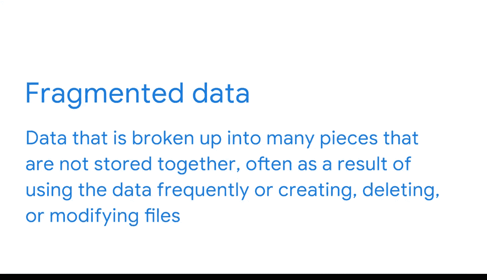

# 谷歌《谷歌商业智能（BI基础、洞察路线：模型和pipelines、决策：数据看板）｜Google Business Intelligence》 p62 23_02_06_优化数据库性能.zh_en -BV1yJ4m1V7W9_p62-

Recently， we've been learning a lot about database performance as a refresher。

 This is a measure of the workload that can be processed by the database。

 as well as associated costs。 We also explored optimization。

 which is one of the most important factors of database performance。😊。

You'll recall that optimization involves maximizing the speed and efficiency with which data is retrieved in order to ensure high levels of database performance。

 In this video， we're going to focus on optimization and how B I professionals optimize databases by examining resource use and identifying better data sources and structures。

 Again， the goal is to enable the system to process the largest possible workload at the most reasonable cost。

😊，So this requires speedy response time， which is how long it takes for a database to respond to a user request。

Here's an example。Imagine you're a BI professional receiving emails from people on your team who say that it's taking longer than usual for them the poll of data they need from the database。

At first， this seems like a pretty minor inconvenience。

But a slow database can be disruptive and cost your team a lot of time。

 If they have to stop and wait whenever they need to pull data or perform a calculation。

 it really affects their work。There are a few reasons that users might be encountering this issue。

Maybe the queries aren't fully optimized， or the database isn't properly indexed or partitioned。

Perhaps the data is fragmented， where there isn't enough memory or CPU。Let's examine each of these。

First， if the queries users are writing to interact with the database are inefficient。

 it can actually slow down your database resources。To avoid this。

 the first step is to simply revisit the queries to ensure they're as efficient as possible。

 The next step is to consider the query plan。In a relational database system that uses SQL。

 a query plan is a description of the steps the database system takes in order to exccate a query。

As you've learned， a query tells the system what to do， but not necessarily how to do it。

So the query plan is the how。If queries are running slowly。

 checking the query plan to find out if there are steps causing more draw than necessary can be helpful。

This is another iterative process。After checking the query plan。

 you might rewrite the query or create new tables and then check the query plan again。Okay。

 now let's consider indexing。An index is an organizational tag used to quickly locate data within a database system。

If the tables within a database haven't been fully indexed。

 it can take the database longer to locate resources。In cloud based systems working with big data。

 you might have data partitions instead of indexes。

 Data partitioning is the process of dividing a database into distinct logical parts in order to improve query processing and increase manageability。

The distribution of data within the system is extremely important。

So ensuring that data has been partitioned appropriately and consistently is part of optimization。

 too。The next issue is fragmentmented data。 fragmentmented data occurs when data is broken up into many pieces that are not stored together。

 often as a result of using the data frequently or creating， deleting or modifying files。

For example， if you are accessing the same data often and versions of it are being saved in your cache。

 those versions are actually causing fragmentation in your system。 Finally。

 if your database is having trouble keeping up with your organization's demands。

 it might mean there isn't enough memory available to process everyone's requests。

Making sure your database has the capacity to handle everything you ask of it is critical。

Consider our example again。You received some emails from the team stating that it was taking longer than usual to access data from the database。

After learning about the slowdown from your team， you were able to assess the situation and make some fixes。

Addressing the issues allowed you to ensure the database was working as efficiently as possible for your team。

 problem solved。But database optimization is an ongoing process。

 and you'll need to continue to monitor performance to keep everything running smoothly。

