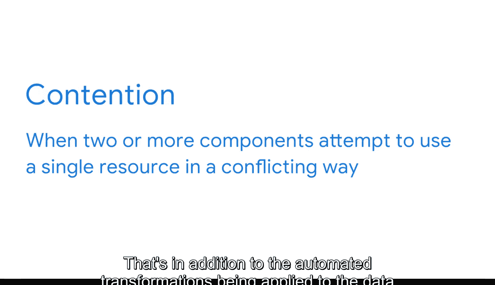

# 谷歌《谷歌商业智能（BI基础、洞察路线：模型和pipelines、决策：数据看板）｜Google Business Intelligence》 p63 24_02_10_五要素实战应用.zh_en -BV1yJ4m1V7W9_p63-

Earlier， we learned about the five factors of database performance， workload， throughput， resources。

 optimization and contention。But how do they actually operate within a working system？

Let's explore a database and witness how the five factors affect its performance Before we get into how the five factors influence this database。

 let's understand how it's been designed。In this example。

 we'll be checking out a movie theater chain system。

 There are a few things that we'll need to consider during optimization。 First。

 let's think about what this database is being used for。In this case。

 the movie theater chain uses data related to ticket purchases。

 revenueue and audience preferences in order to make decisions about what movies to play and potential promotions。

 Second， we'll consider where the data is coming from。In this example。

 it's being pushed from multiple sources into an OLAP system where analysis takes place。Also。

 the database uses data from individual theaters OLTP systems in order to explore trends in ticket sales for different movie times and genres。

The OLTP systems that manage transaction data use a snowflake database model。At the centre。

 there is a fact table capturing the most important information about the tickets。

 such as whether or not a specific seat has been reserved。 The reservation type， the screening I D。

 the employee I D of whoever entered the reservation， and the seat number。

 in order to capture details about these facts。 The model also includes several dimension tables connected to the fact table with information on employee。

 movie， Sc， auditorium， seat and reservation。This database is fairly straightforward。

 and it enables each movie theater to record data in these different tables and prevents them from accidentally booking the same seat twice。

😊，However， these individual OLTP systems aren't designed for analysis。

 which is why the data needs to be pulled into the destination OLAP system。There。

 it can be accessed and explored by users in order to gain insights and make business decisions。Okay。

Now that we know a little more about our database， let's find out how the five factors of database performance influence it。

First， as you know， workload is a combination of transactions， queries， data warehousing analysis。

 and system commands being processed by the database system at any given time。In this case。

 most of the workload is processing user requests， such as generating scheduled reports or fulfilling queries。

If the database can't handle the workload， it might cause a system to crash。

 disrupting users' ability to access and use the data。

Maybe the report requires a lot of resources to generate。

 or there might be a growing number of analysts accessing this data。

 but we know that it's often possible to predict peak workload times so we can make adjustments to ensure the system can handle these requests。

 Now， let's explore throughput。Again， this is the overall capability of the database's hardware and software to process requests。

Because our movie theater system is mostly focused on analysis of data from OLTP databases。

 we're working with an OAP database that primarily uses cloud storage。

 the database storage processes and the computers within the system that are accessing the cloud data need to be capable of handling the theater's workload。

 especially when the database system is being used a lot。

 The hardware and software that compose the system's throughput are the resources。For example。

 the movie theaters might use a cache controller disc to help the database manage the storage and retrieval of data from the memory systems。

Next， we have optimization， which you've already learned a lot about。Ideally。

 users should be able to access transaction data that has been ingested from multiple other database systems。

If retrieval slows down， it can take longer to get the data and provide insights to stakeholders。

This is why keeping the database optimized， even after it has been set up is important。

 The last factor of database performance is contention。

The movie theater company has a team with many different analysts accessing and using this data。

That's in addition to the automated transformations being applied to the data and the reports being generated。

All these requests can end up competing with each other， and cause contention。

And this can potentially be problematic if the system processes multiple requests at the same time。

 essentially making the same updates over and over to limit this。

 the database processes queries in the order the requests are made。

 And now you've gotten a chance to explore how the five factors of database performance might affect a real database system。

No matter how simple or complex， these are essential considerations for any BI professional。

