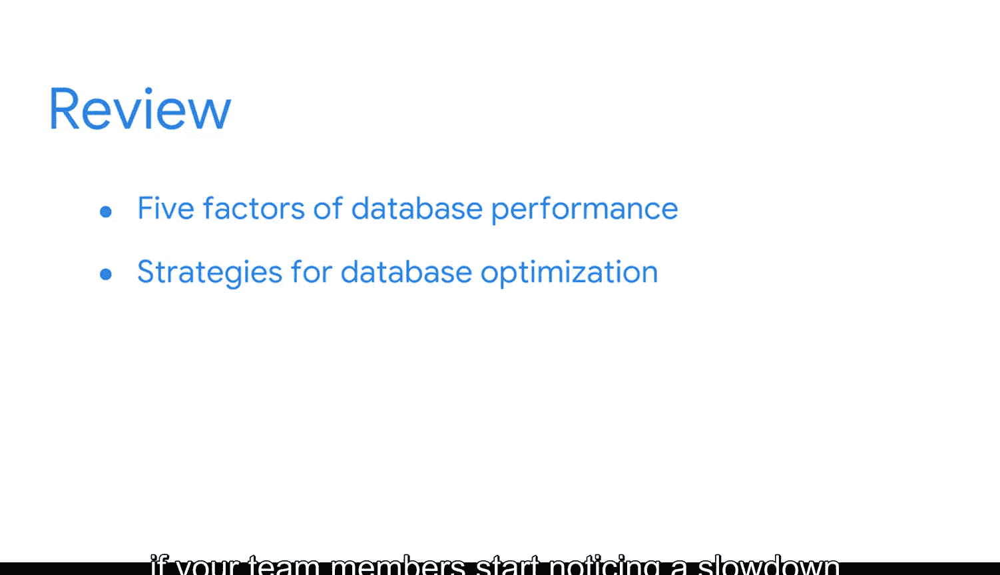

# 谷歌《谷歌商业智能（BI基础、洞察路线：模型和pipelines、决策：数据看板）｜Google Business Intelligence》 p64 25_02_01_总结回顾_2.zh_en -BV1yJ4m1V7W9_p64-

You've been learning about database design and the role BI professionals play in creating and maintaining useful database systems。

So far， you focus on the five factors of database performance， workload， throughput， resources。

 optimization and contention。You also learn some strategies specifically for database optimization and what issues to check for if your team members start noticing a slowdown。

 you even explored how the five factors can affect actual databases。

 database optimization and the importance of keeping databases up to speed as a B I professional。

 developing processes that enable your team to pull insights themselves is a key part of the job。😊。

But systems and processes change over time。They stop working or need to be updated。

That's one of the reasons why continuing to monitor database performance is so important。

The database system should have lasting high performance levels。Coming up。

 you're going to discover more about optimizing systems and the tools you'll create as a BI professional。

But first， you have another weekly challenge。As always。

 feel free to check back over any of the material and review the glossary to prepare yourself for success。

😊，Once you've completed your assessment， I'll meet you back here for more about optimizing ETL processes Great job。

