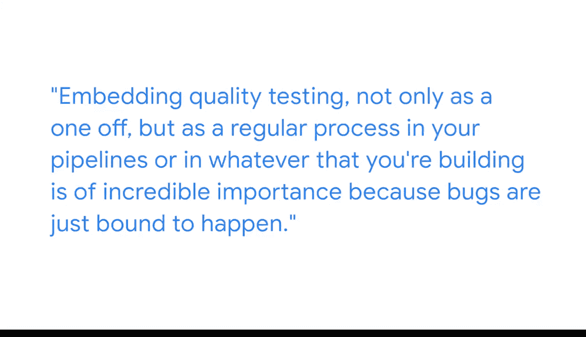

# 谷歌《谷歌商业智能（BI基础、洞察路线：模型和pipelines、决策：数据看板）｜Google Business Intelligence》 p67 28_03_05_玛娜：优质数据即有效数据.zh_en -BV1yJ4m1V7W9_p67-

My name is Monna and I am a senior technical data program manager at Google and what that means is that I work with business partners and I help create tools that help enable them to make better decisions with data I'm a big data nerds so I love playing around with data and getting to build cool stuff that makes people's jobs a lot easier So there's a common saying that in the absence of data you have dirt and I like to take that a step further I like to say in the absence of good data you have dirt quality testing is all about how do you make sure that you have good data and good data can mean a number of different things Oftentimes it means accurate data so how do you ensure that the numbers you're producing are correct and they're representative of the truth it can also mean relevant data it can also mean representative data it can also mean quick data at your fingertips right so the process of quality control is making sure that the tools that you're building with respect to data。

Are accurate， helpful， relevant and timely There are many times across the lifecycl of building a B product in which quality testing comes into play。

 So if you think of the very early stages where maybe someone is trying to extract data from logs。

 you're going to want to make sure that the data that you're extracting is accurate So is the same data that's coming in through the logs。

 the same data that's being spit out from the data mark maybe that I'm creating it's the same idea through your ETL processes where ETL means extract transform and load。

 So as you're grabbing the data you're transforming it。

 you're massaging it and you're creating relevancy with that data。

 you want to make sure that the data you got in is the same data you're spinningi out I remember when I was a young professional。

 I was always imagining that one day would land at a company that was data nirvana and all of their data would be so clean ands so perfect and it was just magical I could just query it with no worries in the world and the truth is that nirvana does not exist anywhere。

Data always has issues， there are always bugs that come up。

 even the data that you were looking at today might be different than the data that you look at tomorrow。

 so embedding quality testing not only as a one-off but as a regular process in your pipelines or in whatever that you're building is of incredible importance because bugs are just bound to happen。

There are a couple of things that I wish I knew when I was starting out。

 I wish that I had fully been able to recognize how many skills I had in this department that came from other parts of my life and weren't the traditional means of B skills。

 And with that having more confidence in myself because I came in with really fantastic storytelling skills that I was really able to hone in on。

 And even though I wasn't a software engineer， I had a lot of experience coding。

 And I knew a lot of best practices that I was able to put in place。

 So I would say that if there are areas that you feel like you're maybe off the strongest end that if you stay curious and you stay open and you stay humble and you find folks that are really great at those and you ask them。

 hey， how do you do that。 know that you can learn and you can grow in those capacities and you can become continuously wellrounded。

 It's very normal for us as humans to have our strengths in our growth areas， but being successful。

 is not having them innately， it's having the ability to constantly evolve better。😊。

self and not become the expert， but just become better than you were yesterday。

