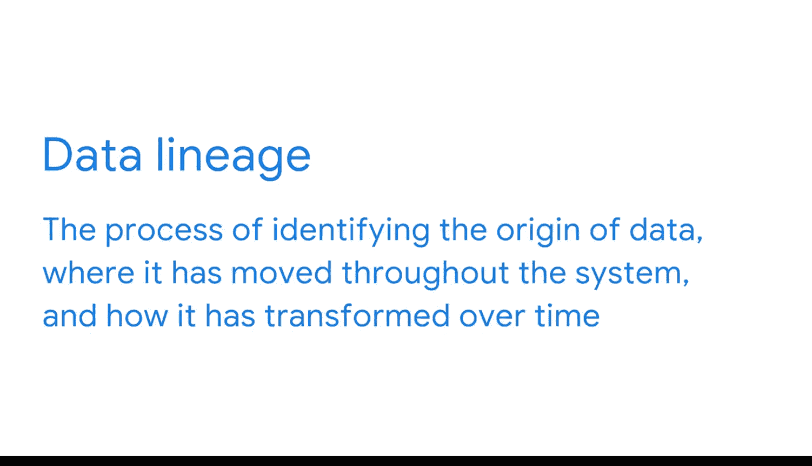

# 谷歌《谷歌商业智能（BI基础、洞察路线：模型和pipelines、决策：数据看板）｜Google Business Intelligence》 p68 29_03_01_从源头到目标的合规性.zh_en -BV1yJ4m1V7W9_p68-

You're learning a lot about the importance of quality testing in ETL。

And you now know that a key part of the process is checking for conformity or whether the data fits the required destination format。

To ensure conformity from source to destination， BI professionals have three very effective tools。

 schemeche of validation， data dictionaries and data lineages。In this video。

 we'll examine how they can help you establish consistent data governance。 First。

 schema validation is a process to ensure that the source system data schema matches the target database data schema。

As you're learning， if the schemas don't align， this can cause system failures that are very difficult to fix。

So building schema validation into your workflow is important to prevent these issues。

 Data tools offer various schemeche of validation options that can be used to check incoming data against the destination schema requirements。

For example， you could dictate that a certain column contains only numerical data。

 Then if you try to enter something in that column that doesn't conform。

 the system will flag the error。Or in a relational database。

 you could specify that an I D number must be a unique field。

That means the same I D can't be added if it matches an existing entry。

This prevents redundancies in the data with these properties in action。

 If the data doesn't conform and throws an error， you'll be alerted。Or if it meets the requirements。

 you'll know it's valid and safe to load。Schema validation properties should ensure three things。

 The keys are still valid after transformation。 The table relationships have been preserved。

 and the conventions are consistent across the database。 Let's start with the keys。

 As you've been learning， relational databases use primary and foreign keys to build relationships among tables。

These keys should continue to function after you have moved data from one system into another。

 For example， if your source system uses customer I D as a key。

 then that needs to be valid in the target scheme as well。

This is related to the next property of schema validation。

 making sure the table relationships have been preserved。When taking in data from a source system。

 it's important that these keys remain valid in the target system。

 so the relationships can still be used to connect tables or that they are transformed to match the target schema。

For example， if the customer ID key doesn't apply to our target system。

 then all of the tables that used it as a primary or foreign key are disconnected。

If the relationships between tables have been broken while data is being moved。

 then the data becomes hard to access and use。 And that's the whole reason we moved it to our target system。

 Finally， you want to ensure that the conventions are consistent with the target database schema。

Sometimes， data from outside sources uses different conventions for naming columns and tables。

For example， you could have a source system that uses employee ID as one word to identify that field。

 but the target database might use employee underscore I。You'll need to ensure these are consistent。

 so you don't get errors when trying to pull data for analysis。

 In addition to the properties themselves， there are some other documentation tools that support data scheme of validation。

 Data dictionaries and data lineages。 A data dictionary is a collection of information that describes the content。

 format and structure of data objects within a database， as well as their relationships。

 You might also hear this referred to as a metadata repository。

You may know that metadata is data about data。This is a very important concept in B。

 So if you'd like to review some of the lessons about metadata from the Google Data Analytic certificate。

 go ahead and do that now。In the case of data dictionaries。

 these represent metadata because they're basically using one type of data。

 metadata to define the use and origin of another piece of data。

 There are several reasons you might want to create a data dictionary for your team。For one thing。

 it helps avoid inconsistencies throughout a project。In addition。

 it enables you to define any conventions that other team members need to know in order to create more alignment across teams。

Best of all， it makes the data easier to work with。Now let's explore data lineages。

Data lineage describes a process of identifying the origin of data。

 where it has moved throughout the system and how it has transformed over time。

This is useful because if you do get error， you can track the lineage of that piece of data and understand what happened along the way to cause the problem。

Then you can put standards in place to avoid the same issue in the future。Using schema validation。

 data dictionaries and data lineages really helps BI professionals promote consistency as data is moved from the source to the destination。

And this means all users can be confident in the B I solutions being created。

We'll keep exploring these concepts soon。