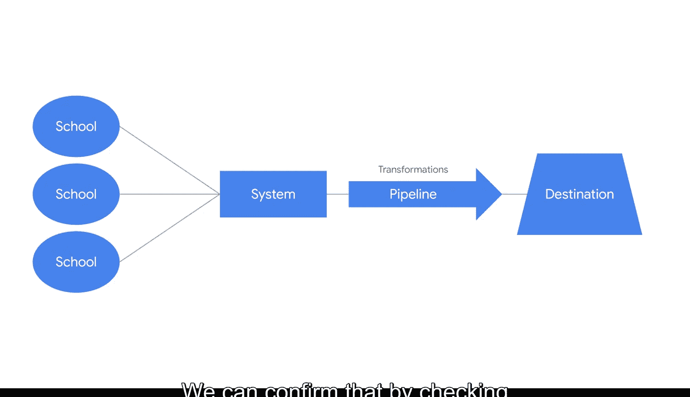

# 谷歌《谷歌商业智能（BI基础、洞察路线：模型和pipelines、决策：数据看板）｜Google Business Intelligence》 p69 30_03_03_检查您的架构.zh_en -BV1yJ4m1V7W9_p69-

One of the best ways to learn is through a case study。

 When you witness how something happened at an actual organization。

 it really brings ideas and concepts to life。So in this video。

 we're going to check out schema governance in action at an educational nonprofit。In this scenario。

 decision makers at the nonprofit are interested in measuring educational outcomes in their community。

In order to do this， they are ingesting data from school databases in order to evaluate learning goals。

 national education statistics， and student surveys。

Because they're pulling data from multiple sources into their own database system。

 it's important that they maintain consistency across all of the data to prevent errors and avoid losing important information。

Luckily， this organization already has a data dictionary and lineage in place to establish the necessary standards。

Let's check out an example of a column from the student information table。

This table has five columns， student ID D， school system， school， age， and grade point average。

Each column in this table has been recorded in the data dictionary to specify what information it contains。

So we can go to the data dictionary entry for the school system column to double check the standard for this table。

As a refresher， a data dictionary is a collection of information that describes the content。

 format and structure of data objects within a database and their relationships。

This dictionary records four specific properties。The name of the column， its definition。

The data type and possible values。The dictionary entry for age lets us know the data objects in this column contain information about a student's age。

It also tells us that this is integer type data。We can use these properties to compare incoming data to the destination table。

If any data objects aren't integer type data， then the scheme of validation will flag the error before the incorrect data is ingested into the destination。

So what happens when a data object fails to schemeche a validation process？

We can actually use the data lineage to trace the journey of this piece of data and find out where in the process we might want to add a quality check。

Again， a data lineage includes information about the data's origin。

 where it is moved throughout the system and how it has transformed over time。

During the schemeche of validation process， this piece of data threw an error because it isn't currently cast as integer type。

When we check the data lineage， we can track this object's movement through our system。

This data is started in an individual schoolss database before being read into the school systems database。

The individual school's data was ingested by our pipeline， along with data from other school systems。

 and then organized and transformed during the movement process。Apparently。

 when this data was input in the school's original database， it wasn't typecast correctly。

We can confirm that by checking its data type throughout the lineage。

The lineage also includes all the transformations that this data has undergone so far。Also。

 we might at this point notice that type casting isn't built into our transformation process during quality checks。

That's great news。Now we know that that's a process we should incorporate into the pipeline before data is read into the destination table。

In this case， age data objects should be integer type。

And that's how schema governance and validation can help improve systems and prevent errors。

There are other kinds of tests that should be applied to a pipeline to make sure it's functioning correctly。

 which we'll learn more about soon。But now you have a better understanding of how to validate the schema and keep improving your pipeline processes。

